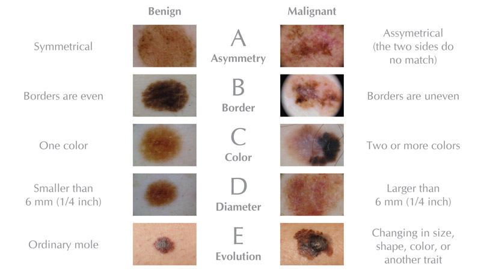
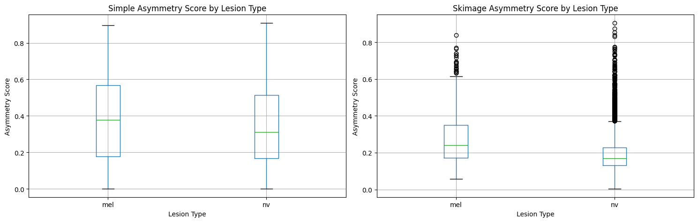
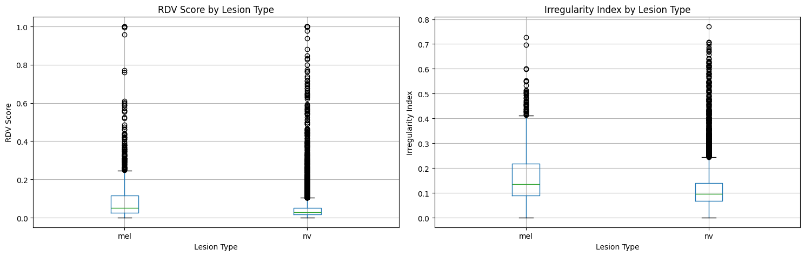
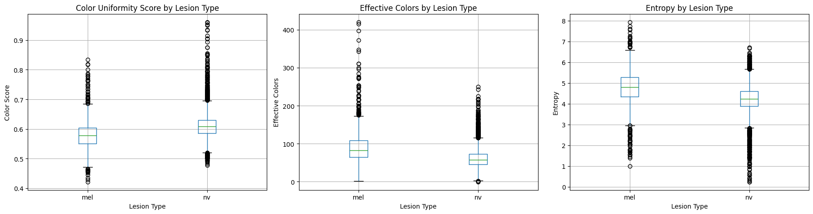

# Deterministische Algorithmen zur Merkmalsextraktion aus Bildern

Die reine Verwendung eines neuronalen Klassifikators bringt den Nachteil mit sich, dass die Art und Weise der Klassifizierung eines Bildes für den Menschen nicht nachvollziehbar ist.
Da dieses Projekt im medizinischen Kontext genutzt werden soll, ist die Nachvollziehbarkeit von Entscheidungen eine grundlegende Voraussetzung.

Ein klassischer Arbeitsschritt von Dermatologen bei der Analyse von Hautläsionen ist die Anwendung der sogenannten [ABCDE-Kriterien](https://www.aad.org/public/diseases/skin-cancer/find/at-risk/abcdes), die verschiedene visuelle Merkmale einer Läsion bewerten.
Diese Kriterien sind ein etabliertes Werkzeug für Dermatologen, um die Merkmale von Hautläsionen zu bewerten. Durch die Implementierung von Algorithmen, die diese Kriterien quantifizieren, können erklärbare Informationen bereitgestellt werden, die Ärzten helfen, fundierte Entscheidungen zu treffen.

Das folgende Bild stellt die Kriterien im Vergleich zwischen einem gutartigen Leberfleck (links) und einem bösartigen Melanom (rechts) dar:

Quelle: https://www.aimatmelanoma.org/melanoma-101/understanding-melanoma/moles-and-other-lesions/know-your-abcdes/

Da die Kriterien als weit verbreitet und klinisch relevant gelten, sollten sie in unserem Projekt ebenfalls berücksichtigt werden. Allerdings ist die direkte Implementierung von Diameter (D) und Evolution (E) aufgrund der fehlenden zeitlichen Daten und der Skalierungsproblematik nicht trivial, weshalb der Fokus auf die Kriterien A, B und C gelegt wurde.

## Details zur Implementierung

Für jedes der drei Kriterien (Asymmetrie, Border und Color) wurden zwei verschiedene Implementierungsansätze entwickelt und verglichen. Alle Ansätze wurden in Python implementiert, wobei für jedes Kriterium festgestellt werden soll, welcher Algorithmus am geeigneten ist. 

Für die Berechnung zu den ABC-Kriterien muss die eigentliche Läsion von ihrem Hintergrund getrennt werden. Die Segmentierung wird in Form einer sogenannten binären Maske durchgeführt, die für jedes Pixel angibt, ob es zur Läsion gehört oder nicht.
Alle Vergleiche von Implementierungsansätzen nutzen Otsu's Thresholding um eine binäre Maske der Läsion zu erstellen. 
Details zu den beiden getesteten Ansätzen finden sich in der [zugehörigen Beschreibung](../abc_algorithms/lesion_cutout.md). Darin sind auch die Vor- und Nachverarbeitungsschritte beschrieben, die für beide Ansätze notwendig sind, um die Qualität der Segmentierungsergebnisse zu verbessern.

Um die Leistung der Algorithmen zu bewerten, wurden sie auf alle 10000 Bilder angewandt und die berechneten Scores nach den beiden relevanten Klassen (Melanom vs. Leberfleck) gruppiert.
Ein Boxplot dient der Visualisierung der Verteilung der Scores in den beiden Klassen, um die Differenzierungskraft des Algorithmus zu bewerten. Ein signifikanter Unterschied in der Verteilung der Scores zwischen den Klassen würde darauf hindeuten, dass der Algorithmus relevante Merkmale extrahiert, die zur Unterscheidung beitragen können.

### Kriterium A - Asymmetry (Asymmetrie)

Die Asymmetrie eines Muttermals ist eines der wichtigsten Indikatoren zur Unterscheidung zwischen gutartigen Muttermalen und Melanomen. Während gutartige Muttermale in der Regel symmetrisch sind, weisen Melanome oft eine unregelmäßige Form auf, die zu Asymmetrie führt. 

Dazu sollen zwei Ansätze zur Quantifizierung der Asymmetrie auf einer Skala von 0 (völlig symmetrisch) bis 1 (völlig asymmetrisch) verglichen werden. 
Für die Berechnungen wird ausschließlich die binäre Maske der Läsion verwendet. Farbwerte spielen bei der Asymmetrie-Berechnung keine Rolle, da die Form der Läsion im Vordergrund steht.

#### Ansatz 1: Quadranten-basierte Punktsymmetrie

Dieser Ansatz basiert auf der vereinfachten Annahme, dass sich die Symmetrie einer Läsion durch den Vergleich von vier Quadranten (oben links, oben rechts, unten links, unten rechts) beurteilen lässt. Hierbei wird die Anzahl der Pixel in jedem Quadranten gezählt und der absolute Unterschied zwischen gegenüberliegenden Quadranten (Punktsymmetrie) berechnet.

1. Maskenerstellung: Generierung einer binären Maske der Läsion durch Otsu's Thresholding
2. Zentroid-Berechnung: Bestimmung des geometrischen Schwerpunkts der Läsion, um die Quadranten zu definieren
3. Quadranten-Aufteilung: Aufteilung der Maske in vier Quadranten basierend auf dem Zentroid
4. Differenzberechnung: Berechnung der absoluten Differenz zwischen diagonal gegenüberliegenden Quadranten
5. Normalisierung: Mittelung der zwei Differenzwerte und Normalisierung auf [0, 1], wobei 0 = völlig symmetrisch und 1 = völlig asymmetrisch

#### Ansatz 2: Hauptachsen-basierte Spiegelsymmetrie

Dieser Ansatz ist wissenschaftlich präziser, da er die Spiegelsymmetrie entlang der Hauptachse der Läsion bewertet. Da Muttermale oft oval sind, wird die Läsion zuerst an ihrer längsten Ausdehnung ausgerichtet. Die Asymmetrie wird dann über die Schnittmenge und Vereinigung (Intersection over Union, IoU) der gespiegelten Hälften definiert.

1. Maskenerstellung: Generierung einer binären Maske der Läsion durch Otsu's Thresholding
2. Hauptachsen-Berechnung: Bestimmung der Hauptachse durch Bildmomente
3. Geometrische Ausrichtung: Rotation der Maske, um die Hauptachse horizontal auszurichten
4. Symmetrie-Prüfung: Spiegelung der Maske entlang horizontaler und vertikaler Achse und Berechnung der Überlappung 
5. Analyse der Überlappung: Berechnung der IoU zwischen den gespiegelten Hälften, um die Asymmetrie zu quantifizieren
6. Normalisierung: Mittelwert aus horizontaler und vertikaler Asymmetrie, normalisiert auf [0, 1], wobei 0 = völlig symmetrisch und 1 = völlig asymmetrisch

Wie dem Boxplot zu entnehmen ist, eignet sich der Ansatz der hauptachsenbasierten Spiegelsymmetrie deutlich besser zur Differenzierung zwischen Melanomen und Leberflecken, da der Mittelwert der Scores mit 0.27 für Melanome und 0.20 für Leberflecken klarer getrennt ist als bei der quadrantenbasierten Punktsymmetrie (0.37 vs. 0.35). Zudem erstreckt sich das 75. Perzentil der Melanom-Scores bis 0.61, was darauf hinweist, dass Melanome tendenziell deutlich asymmetrischer sind als Leberflecken.

---

### Kriterium B - Border (Grenzziehung)

Unregelmäßige, ausgefranste oder unscharfe Ränder sind ein klinisches Warnzeichen für maligne Hautläsionen. Zur objektiven Quantifizierung dieser Irregularitäten wurden zwei komplementäre Algorithmen implementiert, die unterschiedliche Aspekte der Randgestalt erfassen.

#### Ansatz 1: Radiale Distanzvarianz (RDV)

Die RDV-Methode quantifiziert die Abweichung der Läsionsform von einer idealen Kreisform. Dabei werden die Distanzen vom geometrischen Zentrum (Zentroid) zu allen Punkten auf der Grenzlinie berechnet. Eine perfekt kreisförmige Läsion weist eine minimale Varianz auf, während irreguläre Ränder zu einer hohen statistischen Varianz der Radien führen.

1. Maskenerstellung: Generierung einer binären Maske der Läsion durch Otsu's Thresholding
2. Zentroid-Berechnung: Bestimmung des geometrischen Schwerpunkts der Läsion
3. Bestimmung des Umrisses: Aufblähen der Maske durch Dilation und anschließend Subtraktion der ursprünglichen Maske
4. Radiale Distanzberechnung: Berechnung der euklidischen Distanzen von jedem Punkt auf der Grenzlinie zum Zentroid
5. Varianzberechnung: Ermittlung des Varianzkoeffizienten (Standardabweichung / Mittelwert) der Radien, um die Unregelmäßigkeit zu quantifizieren
6. Normalisierung: Skalierung des RDV-Werts auf [0, 1], wobei 0 = perfekte Kreisform und 1 = maximale Irregularität

#### Ansatz 2: Konkavitäts-Analyse

Dieser Ansatz bewertet die "Zerklüftung" des Randes durch den Vergleich der tatsächlichen Läsionsmaske mit ihrer konvexen Hülle (dem kleinstmöglichen konvexen Set, das die Läsion umschließt). Die Differenz zwischen der konvexen Hülle und der tatsächlichen Maske ergibt die sogenannten Konkavitäten (Einbuchtungen). Das Verhältnis dieser Konkavitätsfläche zur Gesamtfläche der Läsion dient als Maß für die Randunregelmäßigkeit.

1. Maskenerstellung: Generierung einer binären Maske der Läsion durch Otsu's Thresholding
2. Masken-Bereinigung: Entfernung kleiner Löcher in der Maske durch Morphologische Operationen (z.B. Closing)
3. Konvexe Hülle: Berechnung der konvexen Hülle der Maske, um eine glatte Umhüllung der Läsion zu erhalten
4. Konkavitätsfläche: Berechnung der Fläche der Konkavitäten durch Subtraktion der tatsächlichen Maske von der konvexen Hülle
5. Normalisierung: Normalisierung der Konkavitätsflächen durch die Gesamtfläche der Läsion, um einen Wert zwischen 0 (perfekt konvex bzw. sehr gleichmäßige Border) und 1 (maximale Konkavität bzw. sehr unregelmäßige Border) zu erhalten.

Da die Mittelwerte beider Ansätze mit einer Differenz von ungefähr 0.04 relativ nah beieinander liegen und auch die Standardabweichungen sehr ähnlich sind, lässt sich der überlegene Ansatz nur direkt über die Verteilung der Scores beurteilen. Hier zeigt sich, dass der Konkavitäts-Ansatz einen deutlich höheren Zahlenraum an Scores für Melanome abdeckt (bis 0.41) während die Verteilung beim RDV-Ansatz deutlich kompakter ist und nur bis 0.25 reicht. Die starke Überlappung der Verteilungen beider Ansätze deutet darauf hin, dass auch viele Melanome relativ regelmäßige Ränder aufweisen können, was die Differenzierung erschwert. Dennoch scheint der Konkavitäts-Ansatz aufgrund seiner größeren Varianz bei Melanomen eine etwas bessere Trennung zu ermöglichen.

---

### Kriterium C - Color (Färbung)

Die Farbanalyse ist ein entscheidendes Merkmal bei der Detektion maligner Melanome, da diese oft eine ausgeprägte Farbvariabilität (Variegation) aufweisen. Während gutartige Läsionen meist einfarbig oder homogen gefärbt sind, zeigen Melanome häufig verschiedene Nuancen von Braun, Schwarz sowie rötliche, bläuliche oder graue Areale.

Um die Farbvielfalt unabhängig von individuellen Hauttypen und variierenden Beleuchtungsbedingungen zu quantifizieren, wird eine [relative Farbhistogramm-Analyse](https://pmc.ncbi.nlm.nih.gov/articles/PMC3184460/) eingesetzt. Der Kern dieses Ansatzes besteht darin, nicht die absoluten RGB-Werte zu betrachten, sondern die Abweichung der Läsionspixel von der durchschnittlichen Hautfarbe der Umgebung. Die Komplexität dieser Farbverteilung wird mathematisch über die Shannon-Entropie gemessen: Eine hohe Entropie korreliert mit einer größeren Vielfalt an relativen Farben und deutet somit auf eine höhere Wahrscheinlichkeit für ein Melanom hin.

1. Maskenerstellung: Generierung einer binären Maske der Läsion durch Otsu's Thresholding
2. Hautfarbenermittlung: Berechnung der durchschnittlichen Hintergrund-Hautfarbe, um eine individuelle Referenz für das jeweilige Bild zu erhalten
3. Relative Farbberechnung: Von jedem Pixel innerhalb der Läsion wird die Differenz zu der durchschnittlichen Hautfarbe berechnet, um relative Farbwerte zu erhalten
4. Farbquantisierung: Quantisierung der relativen Farbwerte in ein 3D Histogram mit 32 Bins pro Farbkanal (ergibt 32768 mögliche Farbklassen), um die Komplexität der Farbverteilung zu reduzieren. Ähnliche Farben werden in denselben Bin gruppiert, um die Analyse zu vereinfachen.
5. Histogram-Filterung: Entfernung von Bins, die zu nah an dem Bin der durchschnittlichen Hautfarbe liegen, um Rauschen durch Hintergrundpixel zu minimieren
6. Entropie-Berechnung: Quantifizierung der Farbvielfalt durch Berechnung der Shannon-Entropie des gefilterten Histograms.
7. Normalisierung: Inversion der Entropie und Skalierung auf [0, 1], wobei 0 = hohe Farbvielfalt (eher gutartig) und 1 = geringe Farbvielfalt (eher bösartig) bedeutet.

Da für dieses Kriterium nur ein Ansatz implementiert wurde, kann die Differenzierungskraft nur an der Analyse des Color Uniformity Scores selbst beurteilt werden. Die weiteren Boxplots zu `Effective Color Count` und `Entropy` sind lediglich die Rohwerte der Farbvielfalt darstellen, ohne die Normalisierung und Inversion, die für die finale Score-Berechnung notwendig sind.
Die Verteilung des Uniformity Scores zeigt wieder eine deutliche Überlappung zwischen Melanomen und Leberflecken, wobei die Mittelwerte ähnlich zu den vorherigen Kriterien, mit einer Differenz von 0.031, relativ nah beieinander liegen. Nur der Abstand zwischen den 25. Perzentilen der beiden Klassen lässt darauf schließen, dass die Farbvielfalt bei Leberfleck tendenziell geringer ist als bei Melanomen. 

## Übertrag auf die App

Die Algorithmen zur Berechnung der ABC-Kriterien wurden in Python implementiert, da sie dort einfacher zu entwickeln und zu testen sind. Für die Integration in die Flutter-App müssen diese Algorithmen jedoch in eine Form gebracht werden, die auf mobilen Geräten lauffähig ist.
Die [OpenCV-Bibliothek](https://en.wikipedia.org/wiki/OpenCV) wurde bereits in der Python-Implementierung verwendet, um die Bildverarbeitungsschritte durchzuführen. Glücklicherweise bietet OpenCV auch eine native C++-Implementierung, die über Dart-FFI in Flutter eingebunden werden kann.
Ein Vergleich der Inferenz auf beiden Plattformen (Python vs. Flutter) zeigt, dass die Berechnung der ABC-Kriterien auf mobilen Geräten ohne signifikante Verzögerung möglich ist. Dabei sind die (Zwischen)Ergebnisse der ABC-Algorithmen identisch.

## Siehe auch
- [Läsionssegmentierung](./lesion_cutout.md)
- [ML Dokumentation](../ml/README.md)