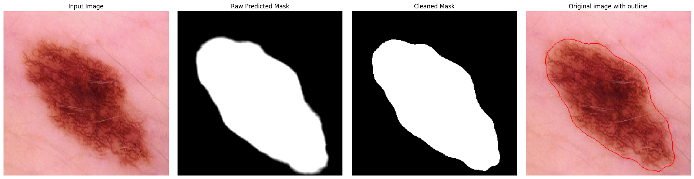

# Algorithmen für Läsionsmasken

Das Ausschneiden einer Läsion aus einem Hautbild ist eine wichtiger Vorverarbeitungsschritt für die Anwendung der ABC-Kriterien, da diese sich auf die Analyse der Läsion selbst und nicht auf den Hintergrund konzentrieren. Da jedoch jede Läsion eine individuelle Form, Textur und Farbverteilung aufweist, ist die Segmentierung eine komplexe Aufgabe, die durch klassische Bildverarbeitungsalgorithmen nicht in allen Fällen zuverlässig gelöst werden kann.

## Ansätze

**Otsu's Thresholding**: Ein klassischer Ansatz zur Segmentierung von Hautläsionen ist die Verwendung von Schwellenwertverfahren, wie z.B. der [Otsu-Methode](https://en.wikipedia.org/wiki/Otsu%27s_method), um eine binäre Maske zu erstellen. Diese Methode basiert auf der Analyse der Graustufenverteilung eines Bildes und sucht nach einem optimalen Schwellenwert, der die Läsion vom Hintergrund trennt.

**U-Net basierte Segmentierung**: Als alternativer Ansatz soll die Segmentierung durch ein neuronales Netz erfolgen, das speziell für die Segmentierung von Hautläsionen trainiert wurde. Die Hoffnung besteht darin, dass solche Modelle lernen können, die komplexen Merkmale einer Läsion zu erkennen und eine binäre Maske zu erstellen, in den Fällen, in denen klassische Algorithmen versagen.

Auf Kaggle wurden von Teilnehmern verschiedene Implementierungen veröffentlicht. Das [vielversprechendste Beispiel](https://www.kaggle.com/code/dota2player/skin-lesion-segmentation-using-unet) setzt auf die Verwendung einer **U-Net** Architektur, welche durch ihre Encoder-Decoder Struktur für die Erstellung einer binären Maske geeignet ist. 
Das veröffentlichte Modell wurde für unser Ziel der Anwendung auf mobilen Endgeräten übernommen. 

## Vorverarbeitung und Nachverarbeitung

Die Qualität der binären Läsionsmaske ist entscheidend für die Genauigkeit der ABC-Kriterien. Für beide Ansätze werden mehrere Vor- und Nachverarbeitungsschritte durchgeführt, um optimale Ergebnisse zu erzielen.

### Vorverarbeitung

Die Vorverarbeitung ist für beide Ansätze ähnlich hat aber zwei wesentliche Unterschiede. Zum einen muss das Bild für die Anwendung von Otsu's Methode in Graustufen konvertiert werden, während das U-Net-Modell mit RGB-Bildern trainiert wurde und daher die Farbinformationen erhalten bleiben müssen. Zum anderen erwartet das U-Net-Modell eine feste Eingabegröße von 256×256 Pixeln, weshalb hier eine Größenanpassung notwendig ist, während Otsu's Methode auf Bildern beliebiger Größe angewendet werden kann. 

#### Vorverarbeitung für Otsu's Thresholding

1. Graustufen-Konvertierung: Das RGB-Bild wird in ein Graustufenbild umgewandelt, da Otsu's Methode auf der Analyse der Graustufenverteilung basiert.

#### Vorverarbeitung für das U-Net-Modell

1. Zuschneiden auf feste Eingabegröße des Modell von 256×256 Pixeln. Dabei wird `INTER_NEAREST` als Interpolationsmethode verwendet, um scharfe Kanten zu erhalten.

2. Normalisierung der Pixelwerte werden für stabile Gradienten während der Inferenz

Diese Schritte stellen sicher, dass die Eingabedaten konsistent mit der Datengrundlage des trainierten Modells sind und dass die Inferenz zuverlässige Ergebnisse liefert.

### Nachverarbeitung

Die Nachverarbeitung gliedert sich in zwei Phasen: **1. modellspezifische Schritte zur Umwandlung** der Netzausgabe und **2. allgemeine Bereinigungsschritte**, die unabhängig von der Segmentierungsmethode (neuronales Netz oder Otsu-Thresholding) angewendet werden.

#### Modellspezifische Nachverarbeitung für Otsu's Thresholding

Der Schwellenwert Ansatz hat Probleme Haare oder andere Artefakte zu entfernen, die nicht zur Läsion gehören. Resultat ist eine binäre Maske, die zwar teilweise korrekt Haare entfernt, was allerdings auch zu einem Verlust von Läsionsanteilen führen kann, wenn die Läsion stark fragmentiert ist. Es hat sich gezeigt, dass die Anwendung von morphologischen Operationen "Schließen" (Closing) und "Öffnen" (Opening) die Maske bereinigt, indem kleine Löcher gefüllt und kleine Artefakte entfernt werden. Diese Schritte verbessern die Qualität der Maske erheblich. Andererseits wird damit auch die Form verändert, was den Wahrheitsgehalt der ABC-Scores beeinträchtigt. Insofern wird auf die Anwendung von Morphologischen Operationen verzichtet, um die Form der Läsion so originalgetreu wie möglich zu erhalten.

#### Modellspezifische Nachverarbeitung für das U-Net-Modell

Das U-Net-Modell gibt für jeden Pixel einen Logit-Wert aus, der zunächst in eine Wahrscheinlichkeit umgewandelt werden muss. Zum einen wird die Sigmoid-Aktivierungsfunktion angewendet, um die Werte in den Bereich [0, 1] zu skalieren, also die Wahrscheinlichkeit, dass ein Pixel zur Läsion gehört. Dadurch, dass das Modell immer Wahrscheinlichkeitswerte liefert, ist die Maske weicher und kann auch Unsicherheiten an den Rändern der Läsion darstellen. Durch die Anwendung eines empirisch ermittelten Schwellenwerts von `0.7` wird die Maske anschließend binarisiert, um eine klare Trennung zwischen Läsion und Hintergrund zu erreichen. Dieser höhere Schwellenwert im Vergleich zum Standardwert von `0.5` reduziert die Anzahl der falsch positiven bzw. unsicherer Pixel am Rand der Läsion, was zu einer präziseren Segmentierung führt.

Die Maske wird außerdem auf die ursprüngliche Bildgröße zurückskaliert, um mit dem Originalbild korrespondieren zu können. Dabei wird wieder `INTER_NEAREST` verwendet, um harte Kanten zu erhalten.

Das nachfolgende Bild zeigt die Anwendung des neuronalen Modells auf ein Beispielbild. Es enthält das Originalbild, die rohe binäre Maske des Modells, die bereinigte Maske und die Überlagerung der Maskengrenze auf das Originalbild.

## Vergleich der beiden Methoden

Die beiden Ansätze haben jeweils ihre Vor- und Nachteile. Otsu's Methode ist einfach zu implementieren und benötigt keine Trainingsdaten, aber sie kann bei komplexen Läsionen oder ungleichmäßiger Beleuchtung versagen. Das U-Net-Modell kann komplexe Merkmale lernen und eine präzisere Segmentierung liefern, erfordert jedoch eine umfangreiche Trainingsphase und ist rechenintensiver.

Anhand des Beispiel Bildes zeigt sich, dass beide Methoden ihre Stärken und Schwächen haben. In dem verwendeten Datensatz gibt es Fälle, in denen Otsu's Methode eine akzeptable Maske liefert, aber auch Fälle, in denen sie versagt und das U-Net-Modell eine deutlich bessere Segmentierung ermöglicht. Ebenso gibt es Fälle in denen beide Ansätze kein nutzbares Ergebnis liefern, was die Herausforderung der Segmentierung von Hautläsionen verdeutlicht. In der Praxis wird die Entscheidung der besseren Maske durch den Dermatologen selbst getroffen. Damit ist die Implementierung beider Ansätze sinnvoll, um in der App eine Auswahlmöglichkeit zu bieten und die bestmögliche Maske für die Anwendung der ABC-Kriterien zu erhalten.