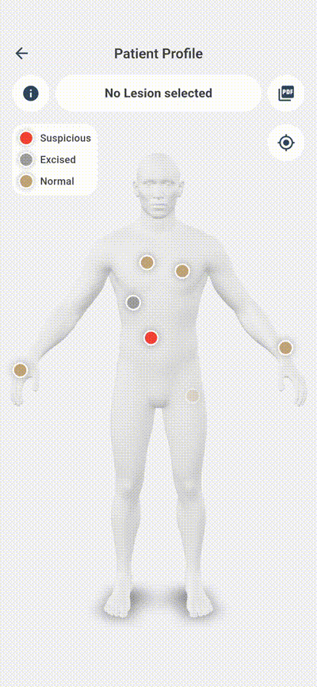
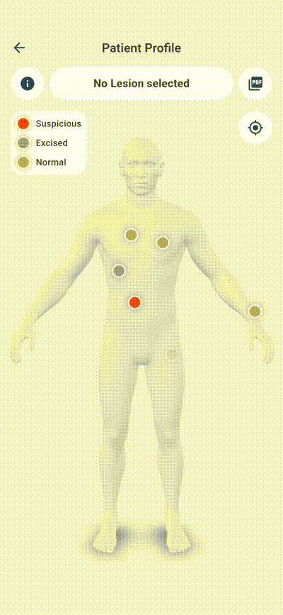
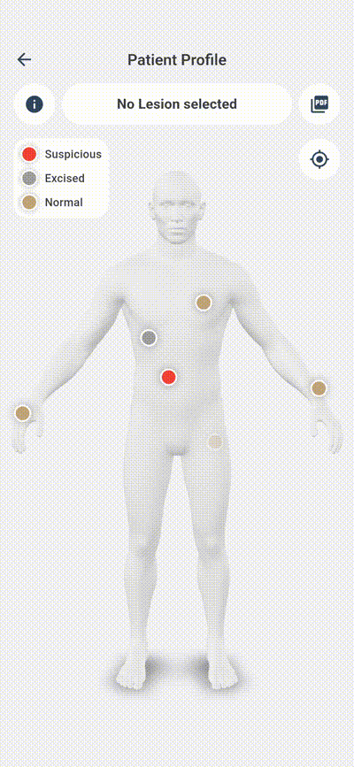

# App-Features

Der Funktionsumfang der Anwendung ist exakt auf den klinischen Untersuchungspfad abgestimmt. Er begleitet den Arzt vom Erstkontakt über die visuelle und KI-gestützte Analyse bis hin zur Archivierung.

## Patientenverwaltung und Anamnese

Das Anlegen eines neuen Patienten bildet den Startpunkt der Dokumentation. Die zu erfassenden Parameter wurden gemeinsam mit der Fachärztin definiert. Sie umfassen neben den demografischen Stammdaten gezielt jene Risikofaktoren, die für eine fundierte Hautkrebsdiagnostik und -prävention maßgeblich sind:

* **Stammdaten:** Vorname, Nachname, Geburtsdatum, biologisches Geschlecht.
* **Sonnen- und Lebensstilfaktoren:** Nutzung von Sonnenschutzmitteln, Historie von Sonnenbränden, Nutzung von Solarien.
* **Medizinische Vorgeschichte:** Eigene Melanom-Vorgeschichte, familiäres Vorkommen von Hautkrebserkrankungen, vorausgegangene dermatologische Operationen.
* **Herkunft:** Geburtsland sowie aktuelles Wohnsitzland (zur Einschätzung der kumulativen UV-Exposition).

Alle Daten können bei Folgeuntersuchungen aktualisiert werden. In der zentralen Patientenübersicht werden diese Risikofaktoren kompakt zusammengefasst, um dem Arzt sofort den Kontext des Patienten zu vermitteln.

```
+-----------------------------------------------------------------------+
| [SCREENSHOT: Patienteninformationen / Detailansicht bzw. Bottom Sheet]|
+-----------------------------------------------------------------------+

```


## Das digitale Patientenprofil & Interaktive 3D-Körperkarte

Das Patientenprofil ist die zentrale Arbeitsumgebung für den Mediziner. Um eine intuitive Dokumentation zu ermöglichen, wurde eine interaktive 3D-Körperdarstellung integriert. Im Gegensatz zu klassischen Systemen, die mit starren, vordefinierten Text-Kategorien (z. B. „Rücken“) arbeiten, erlaubt dieses Modell die präzise Platzierung von Hautläsionen im dreidimensionalen Raum.

### Funktionen der 3D-Körperkarte:

* **Freie Interaktion:** Das dreidimensionale Modell lässt sich stufenlos drehen und zoomen, um jede anatomische Region exakt zu erreichen.
* **Kameraperspektiven:** Ein Quick-Reset erlaubt das sofortige Zurücksetzen auf die Standardansicht.
* **Präzise Läsionsplatzierung:** Durch Tippen auf das Modell können beliebig viele Läsionen exakt an der realen anatomischen Position markiert werden.

```
+-----------------------------------------------------------------------+
| [SCREENSHOT: Interaktives 3D-Körpermodell mit gesetzten Läsionspins]  |
+-----------------------------------------------------------------------+
```


### Schnellübersicht und Navigation

Zusätzlich zur visuellen Karte bietet das Profil eine effiziente Informationsarchitektur für den Praxisalltag:

* **Diagnose-Timeline:** Ein Direktzugriff auf die letzten fünf dokumentierten Diagnosen. Ein Tippen auf einen Eintrag fokussiert sofort die dazugehörige Läsion auf dem 3D-Modell.
* **Kontext-Info:** Schnelleinsicht der Patienten-Risikofaktoren über ein Info-Symbol, ohne den aktuellen Untersuchungsbildschirm verlassen zu müssen.

```
+-----------------------------------------------------------------------+
| [SCREENSHOT: Patientenprofil mit Schnellübersicht und Timeline]       |
+-----------------------------------------------------------------------+
```


## Läsionsverwaltung und Befundung

Wird ein neuer Punkt auf der 3D-Karte gesetzt, öffnet sich der Workflow zur Läsionsverwaltung. Nach Vergabe eines eindeutigen Namens wird ein neuer Untersuchungszeitpunkt (eine Diagnose) initiiert.

### Bildaufnahme und Cutout-Generierung

Der Arzt kann das klinische Bild entweder direkt über die Kamera des Mobilgeräts aufnehmen oder aus der Galerie importieren. Um Störfaktoren (wie gesunde Hautareale oder Haare) zu minimieren und das neuronale Netzwerk auf den relevanten Bereich zu fokussieren, wird im nächsten Schritt ein optimierter Bildausschnitt – der sogenannte Läsions-Cutout – durch den Dermatologen ausgewählt.

```
+-----------------------------------------------------------------------+
| [SCREENSHOT: Workflow zur Auswahl und Bestätigung des Läsions-Cutouts]|
+-----------------------------------------------------------------------+

```

### Medizinische Statusverfolgung

Jede Läsion besitzt einen dynamischen Status, der den klinischen Verlauf widerspiegelt:

* **Verdächtig** (unter Beobachtung)
* **Entfernt** (operativ exzidiert)
* **Histologisch bestätigt** (nach Laborbefund als Melanom klassifiziert)

Da eine Läsion über Jahre hinweg unbegrenzt viele Diagnosen und Bildaufnahmen enthalten kann, wird die morphologische Veränderung lückenlos nachvollziehbar.

## KI-gestützte Analyse und Diagnosedokumentation

Für jede neu erfasste Diagnose wird das Bildmaterial lokal analysiert. Das System kombiniert dabei die klassische dermatologische Bewertungsmetrik mit modernen Deep-Learning-Verfahren:

1. **[Klassisches ABC-Scoring](../abc_algorithms/README.md)** Automatische Berechnung und visuelle Aufbereitung der Kriterien *Asymmetrie* (A), *Begrenzung* (B) und *Color/Farbe* (C).
2. **[Neuronale Klassifikation](../ml/README.md)** Berechnung der statistischen Wahrscheinlichkeiten für das Vorliegen eines *Melanoms* im Vergleich zu einem gutartigen *melanozytären Nävus* (Leberfleck).

Ergänzend dokumentiert der Arzt das Untersuchungsdatum, den behandelnden Kollegen sowie freie klinische Anmerkungen. Die Ergebnisse werden für den Arzt übersichtlich aufbereitet und dienen als objektive, reproduzierbare Zweitmeinung (*Decision Support System*).

```
+-----------------------------------------------------------------------+
| [SCREENSHOT: Diagnoseansicht mit ABC-Scores und KI-Wahrscheinlichkeiten]|
+-----------------------------------------------------------------------+
```


## Automatisierte PDF-Berichterstellung

Für die Archivierung in der primären Praxis-EDV oder für die Weitergabe an den Patienten wurde ein Export-Modul implementiert. Der Arzt kann über eine Checkbox-Auswahl dediziert steuern, welche Läsionen und welche spezifischen Untersuchungszeitpunkte in den Bericht einfließen sollen. Das generierte PDF-Dokument enthält strukturiert alle Stammdaten, Anamnesefaktoren, die bildlichen Dokumentationen, die berechneten KI-Metriken sowie die ärztlichen Kommentare.

```
+-----------------------------------------------------------------------+
| [SCREENSHOT: Export-Dialog und Ansicht des generierten PDF-Berichts]   |
+-----------------------------------------------------------------------+
```



## Siehe auch
- [App-Architektur](./architecture.md)
- [Datenbank Dokumentation](../db/README.md)
- [App-Entwicklung](./README.md)