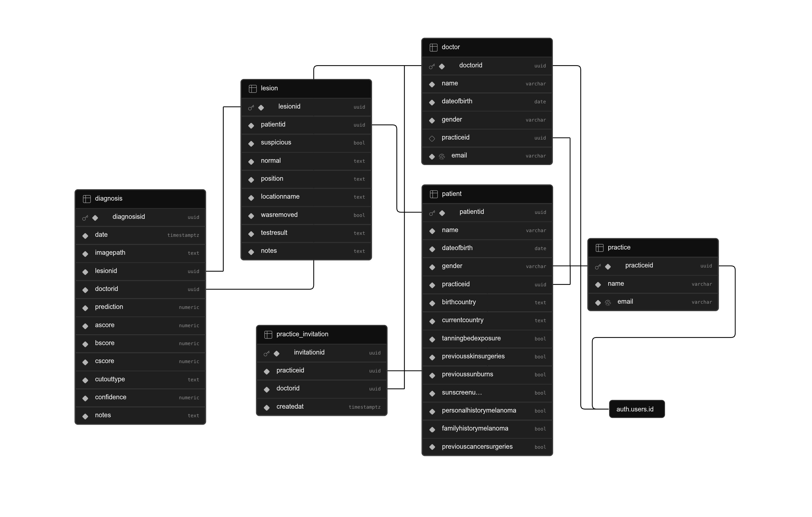

# Datenhaltung und Backend-Architektur

Für das Datenmanagement der **Dermascan**-Applikation wird die Cloud-Plattform **Supabase** eingesetzt. Supabase basiert auf **PostgreSQL**, einer objektrelationalen Datenbank, die ein striktes, stabiles und konsistentes Datenbankschema ermöglicht. Für die aktuelle Prototypen- und Entwicklungsphase reicht die kostenfreie Stufe (*Free Tier*) vollkommen aus, um funktionale Demodaten zu halten und Kernprozesse abzubilden.

## Datenmodell (Schema)

Das relationale Schema wurde so entworfen, dass es den organisatorischen Ablauf einer Arztpraxis sowie den dermatologischen Diagnoseprozess nativ abbildet.

### Zentrale Entitäten und Tabellenstrukturen

Die Datenbank ist in sechs Kernbereiche unterteilt. Nachfolgend werden die Tabellen und ihre spezifischen Aufgaben im System erläutert:

| Tabelle | Beschreibung / Verwendungszweck | Key-Beziehungen |
| --- | --- | --- |
| **`practice`** | Repräsentiert die Arztpraxis als oberste organisatorische Einheit (Mandant). | `practiceid` (PK) |
| **`doctor`** | Speichert Profildaten der Ärzte. Ein Arzt ist zwingend *einer* Praxis zugewiesen. | `doctorid` (PK, FK zu `auth.users`), `practiceid` (FK) |
| **`patient`** | Enthält demografische Daten sowie die detaillierte dermatologische Vorgeschichte des Patienten (z. B. Sonnenbrände, Melanome in der Familie). | `patientid` (PK), `practiceid` (FK) |
| **`lesion`** | Repräsentiert eine spezifische Hautveränderung (Läsion) eines Patienten inklusive Lokalisationsdaten und Status (z. B. ob sie entfernt wurde). | `lesionid` (PK), `patientid` (FK) |
| **`diagnosis`** | Dokumentiert das Ergebnis einer Läsionsuntersuchung. Hier fließen KI-Erkenntnisse und ärztliche Notizen zusammen. | `diagnosisid` (PK), `lesionid` (FK), `doctorid` (FK) |
| **`practice_invitation`** | Verwaltet Einladungen, um Ärzte strukturiert einer Praxis zuzuordnen. | `invitationid` (PK), `practiceid` (FK), `doctorid` (FK) |

### Ausgewählte Datenfelder im Fokus

* **`diagnosis.prediction` & `diagnosis.confidence`:** Halten das Klassifikationsergebnis des Convolutional Neural Networks (CNN) sowie den dazugehörigen Konfidenzwert (Wahrscheinlichkeit für Malignität).
* **`diagnosis.ascore`, `.bscore`, `.cscore`:** Numerische Werte, die aus [deterministischen Bildverarbeitungsalgorithmen](../ml/abc_algorithms.md) hervorgehen (Asymmetrie, Begrenzung, Farbe gemäß der klinischen ABCDE-Regel).
* **`lesion.position` & `lesion.locationname`:** Ermöglichen die exakte Verortung der Läsion am Körper zur späteren visuellen Darstellung auf einer interaktiven 3D-Körperkarte.
* **`auth.users.id`-Verknüpfung:** Die native Supabase-Authentifizierung ist direkt mit den Tabellen `doctor` und `practice` gekoppelt. Ein eingeloggter Account agiert im System entweder in der Rolle einer Praxis oder eines Arztes.
---

## Sicherheitskonzept

Die Absicherung der Daten erfolgt auf zwei komplementären Ebenen: über **Supabase Edge Functions** für Datenbankoperationen und über **Row Level Security (RLS)** für Bilddateien.

### 1. Datenvalidierung und Autorisierung via Edge Functions

Die Erstellung von Diagnosen und das Schreiben kritischer Datensätze erfolgt nicht direkt vom Client aus, sondern wird über serverseitige **Supabase Edge Functions** geschleust.

Beim Aufruf einer Funktion (z. B. zur Speicherung einer neuen Diagnose) werden im Hintergrund folgende Sicherheitsprüfungen durchgeführt:

1. **Identitätsprüfung:** Über das übermittelte JWT (*JSON Web Token*) des Autorisierungs-Headers wird verifiziert, ob der anfragende Nutzer authentifiziert ist und ob seine `auth.uid()` exakt mit der im Payload angegebenen `doctorid` übereinstimmt (Schutz vor Identitätsdiebstahl).
2. **Praxis-Abgleich (Cross-Tenant-Validation):** Die Edge Function löst eine serverseitige Abfrage aus, die prüft, zu welcher `practiceid` der Arzt gehört. Gleichzeitig wird ermittelt, zu welcher `practiceid` der Patient gehört, dessen Läsion untersucht wird. **Nur wenn Arzt und Patient zur selben Praxis gehören, wird die Operation freigegeben.** Andernfalls bricht die Funktion mit einem Fehler (`403 Unauthorized`) ab.

### 2. Dateispeicherung & Storage Row Level Security (RLS)

Medizinische Bilddaten (Aufnahmen der Läsionen) werden im Supabase Storage im Bucket `lesion_images` abgelegt. Um unbefugte Zugriffe zu verhindern, folgt die Verzeichnisstruktur einem strikten Pfadmuster, das vom Client beim Upload erzeugt wird:

Pfadstruktur: `/{practiceId}/{patientId}/{diagnosisId}.jpg`

Der Zugriff auf diesen Bucket wird durch präzise PostgreSQL-Policies (RLS) auf dem Storage-Server reglementiert:

* **Upload-Berechtigung (INSERT):** Ein Arzt darf eine Datei nur hochladen, wenn:
    1. Die Datei die Endung `.jpg` besitzt.
    2. Der erste Ordnername im Pfad exakt mit seiner eigenen `practiceid` übereinstimmt.
    3. Der zweite Ordnername im Pfad zu einem Patienten gehört, der ebenfalls dieser Praxis zugeordnet ist.
    4. Unter diesem Namen nicht bereits eine manipulierte Diagnose-ID existiert.

* **Lese-Berechtigung (SELECT):** Ein Arzt kann Bilder nur dann einsehen oder herunterladen, wenn das Verzeichnis (der erste Ordneraufruf des Pfades) mit der `practiceid` seines eigenen Profils übereinstimmt.

Durch diese Architektur ist mathematisch und datenbankseitig garantiert, dass kein Arzt und keine Praxis jemals – weder absichtlich noch durch Client-Fehler – Einblick in die medizinischen Bilddaten oder Diagnosedaten eines fremden Mandanten erhalten kann.