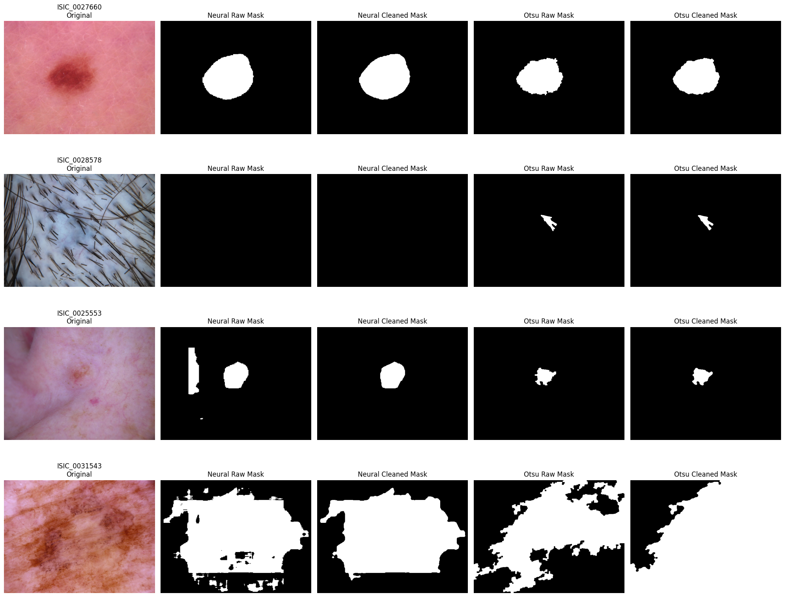

# Deterministische Algorithmen zur Merkmalsextraktion aus Bildern

## Ziel
Die reine Verwendung eines angepassten CNN-Klassifikators bringt den Nachteil mit sich, dass die Art und Weise der Klassifizierung eines Bildes für den Menschen nicht nachvollziehbar ist.
Da dieses Projekt im medizinischen Kontext Verwendung finden soll, ist die Nachvollziehbarkeit von Entscheidungen jedoch eine grundlegende Vorraussetzung.
Aus diesem Grund kam der Gedanke auf, Determinismus in den Prozess der maschinengestützten Entscheidung künstlich einzuführen, wie das Kapitel zur [`Eigenen Klassifikations Architektur`](./multibranch_architecture.md) erklärt.

In der menschlichen Analyse kommen oft die ABCDE-Kriterien als typische Vorgehensweise zur Untersuchung von Hautläsionen.
Ein Teil dieser Kriterien soll nun mit deterministischen Methoden unter Ausgabe eines Scores nachgebildet werden.

## Details zur Implementierung

### Kriterium A - Asymmetry
Das Kriterium der Asymmetrie beschreibt, wie symmetrisch eine Läsion aufgebaut ist.

In der Datei [python/utils/image_asymmetry.py](../../python/utils/image_asymmetry.py) sind die Funktionen `calculate_asymmetry` und `calculate_asymmetry_skimage` implementiert, die den Asymmetrie-Score berechnen.

High Level Ablauf:
```
1. Erstellen einer binären Maske der Läsion im Bild
2. Berechnung des Asymmetrie-Scores durch Vergleich der Hälften der Maske
    2.1. Aufteilen der Maske in linke und rechte Hälfte
    2.2. Spiegeln einer Hälfte
    2.3. Berechnung der Differenz zwischen den beiden Hälften

3. Rückgabe des Asymmetrie-Scores
```


## Verbesserungsmöglichkeiten

### Erstellen einer binären Maske durch trainiertes Modell
Derzeit wird die binäre Maske mit der Otsu-Schwellenwertmethode erstellt. Bei komplexeren Bildern wie Läsionen mit unscharfen Rändern, mehreren Farbtönen oder ähnlichen Hauttönen im Hintergrund kann dies zu ungenauen Masken führen.

Eine mögliche Verbesserung wäre die Verwendung eines vortrainierten Segmentierungsmodells (z.B. U-Netzwerk), das speziell auf die Segmentierung von Hautläsionen trainiert wurde. Dieses Modell könnte eine präzisere Maske liefern, was zu einer genaueren Asymmetrie-Berechnung führen würde.

Im folgenden Bild werden einige Beispiele für Probleme bei der Maskenerstellung gezeigt:



### Optimierung der Asymmetrie-Berechnung durch Vergleich von Implementierungsansätzen

Eine detaillierte Analyse zeigt zwei grundlegend unterschiedliche Implementierungsansätze:

**OpenCV-basierte Implementierung** (`calculate_asymmetry`):
- Vorteil: Hohe Performance durch C++-Backend, inoffizielle Kompatibilität auf anderen Plattformen z.B. `opencv-dart`
- Nachteil: Keine Orientierungserkennung, verwendet einfache geometrische Aufteilung ohne Berücksichtigung der natürlichen Orientierung der Läsion (besser: Ausrichtung entlang der Hauptachse), Vergleich nach Punktsymmetrie ggf. irreführend, wenn Läsion entlang einer schrägen Achse ausgerichtet ist, Normalisierung nach Flächeninhalt des gesamten Bildes statt der Läsion führt zu verfälschten Scores bei kleinen Läsionen (besser: Normalisierung nach Flächeninhalt der Läsion), Skalierung der Maske durch `resize` führt zu Verlust über feine Details der Läsion (besser: np.pad zur Anpassung der Größe ohne Interpolation)

**Scikit-image-basierte Implementierung** (`calculate_asymmetry_skimage`):
- Vorteil: wissenschaftlich genauer, nutzt `regionprops` zur Ausrichtung der Läsion entlang ihrer Hauptachse, Vergleich nach Spiegelsymmetrie ()
- Nachteil: Langsamere Performance durch reine Python/NumPy-Operationen, höhere rechnerische Komplexität, keine Kompatibilität auf anderen Plattformen ohne scikit-image