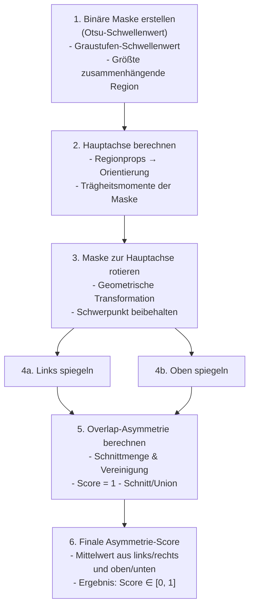
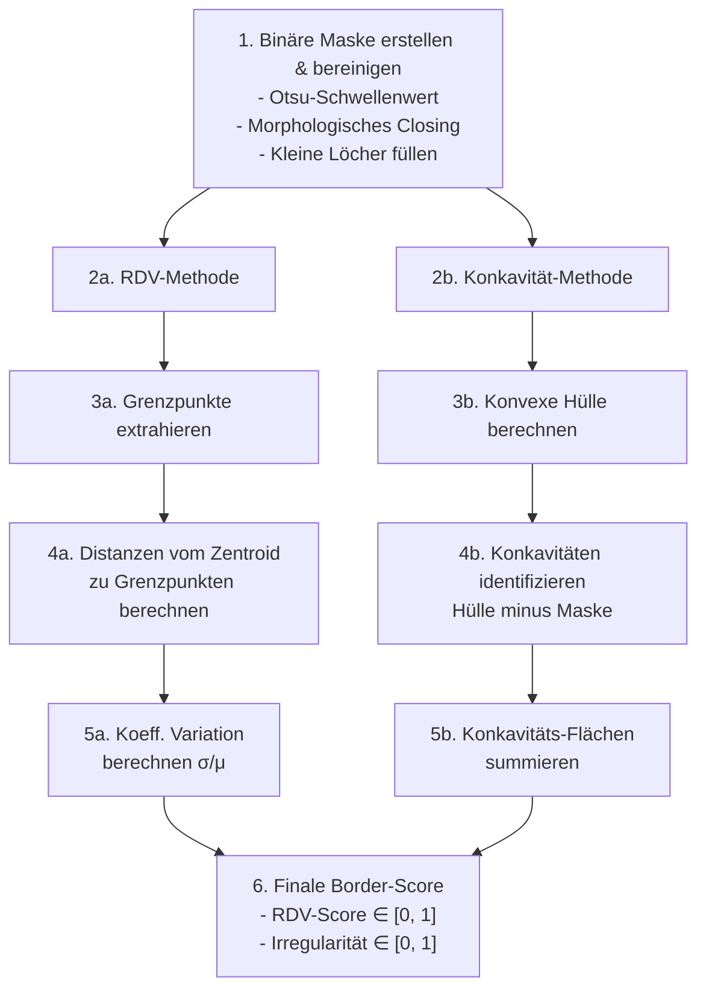
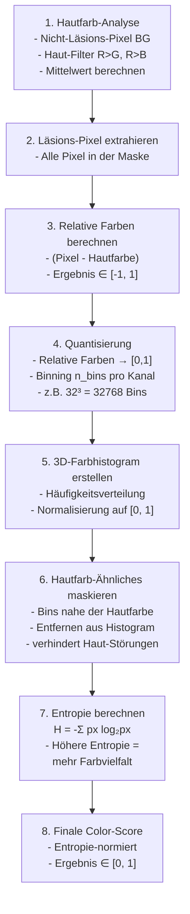

# Deterministische Algorithmen zur Merkmalsextraktion aus Bildern

## Ziel
Die reine Verwendung eines angepassten CNN-Klassifikators bringt den Nachteil mit sich, dass die Art und Weise der Klassifizierung eines Bildes für den Menschen nicht nachvollziehbar ist.
Da dieses Projekt im medizinischen Kontext Verwendung finden soll, ist die Nachvollziehbarkeit von Entscheidungen jedoch eine grundlegende Vorraussetzung.
Aus diesem Grund kam der Gedanke auf, Determinismus in den Prozess der maschinengestützten Entscheidung künstlich einzuführen, wie das Kapitel zur [`Eigenen Klassifikations Architektur`](./multibranch_architecture.md) erklärt.

In der menschlichen Analyse kommen oft die ABCDE-Kriterien als typische Vorgehensweise zur Untersuchung von Hautläsionen.
Ein Teil dieser Kriterien soll nun mit deterministischen Methoden unter Ausgabe eines Scores nachgebildet werden.

## Details zur Implementierung

### Kriterium A - Asymmetry (Asymmetrie)

#### Wissenschaftlicher Hintergrund

Die Asymmetrie eines Muttermals ist eines der wichtigsten Indikatoren zur Unterscheidung zwischen gutartigen Muttermalen und Melanomen. Der Algorithmus quantifiziert, wie stark eine Läsion von Spiegelsymmetrie abweicht.

**Kernidee:** Eine gutartige Läsion sollte in beide Richtungen (vertikal und horizontal) weitgehend symmetrisch sein. Der Algorithmus misst dies durch:
1. **Rotationsausrichtung:** Die Läsion wird entlang ihrer Hauptachse ausgerichtet. Dies wird durch die Berechnung der regionalen Momente erreicht – die längste Achse der Läsion wird horizontal/vertikal positioniert
2. **Spiegelsymmetrie-Vergleich:** Nach Ausrichtung wird die Läsion an der Mittellinie gespiegelt und der Überlappungsgrad zwischen Original und gespiegeltem Bild gemessen
3. **Normalisierung:** Der Asymmetrie-Score wird auf [0, 1] normalisiert, wobei 0 = völlig symmetrisch und 1 = völlig asymmetrisch

#### Ablauf des Algorithmus

---

### Kriterium B - Border (Grenzziehung)

#### Wissenschaftlicher Hintergrund

Hautläsionen mit unscharfen, zackigen oder unregelmäßigen Rändern deuten auf ein höheres Melanom-Risiko hin. Der Algorithmus quantifiziert die Grenzunregelmäßigkeit durch zwei komplementäre Methoden:

1. **Radiale Distanzvarianz (RDV):** Misst die Variation der Entfernungen von der Läsionsmitte zum Rand
   - Berechnet: Standardabweichung / Mittlere Distanz
   - Ergebnis: Maßstabsinvarianter Score für Unregelmäßigkeit

2. **Konkavitäts-Index:** Vergleicht die Läsion mit ihrer konvexen Hülle
   - Konkavitäten = Einbuchtungen zwischen Hülle und tatsächlicher Grenze
   - Normalisierung: Gesamtkoncavity-Fläche / Läsions-Fläche

#### Ablauf des Algorithmus

---

### Kriterium C - Color (Färbung)

#### Wissenschaftlicher Hintergrund

Hautläsionen mit mehreren Farben oder ungleichmäßiger Färbung sind typisch für Melanome. Der Algorithmus quantifiziert die Farbvielfalt durch relative Farbhistogramm-Analyse:

1. **Hautfarb-Normalisierung:** Da die Beleuchtung und der Hauttyp variieren, wird die durchschnittliche Hautfarbe berechnet und als Referenz subtrahiert
2. **Relative Farben:** Lesion-Pixel werden relativ zur durchschnittlichen Hautfarbe ausgedrückt (Farbdifferenz)
3. **Quantisierung:** Die kontinuierlichen Farbwerte werden in diskrete Bins diskretisiert (z.B. 32×32×32-Gitter im RGB-Raum), um „ähnliche" Farben zu gruppieren
4. **Entropie:** Die Verteilung der Farben im Histogram wird durch die Shannon-Entropie gemessen – höhere Entropie = größere Farbvielfalt

## Verbesserungsmöglichkeiten

### Erstellen einer binären Maske durch trainiertes Modell
Derzeit wird die binäre Maske mit der Otsu-Schwellenwertmethode erstellt. Bei komplexeren Bildern wie Läsionen mit unscharfen Rändern, mehreren Farbtönen oder ähnlichen Hauttönen im Hintergrund kann dies zu ungenauen Masken führen.

Eine mögliche Verbesserung wäre die Verwendung eines vortrainierten Segmentierungsmodells (z.B. U-Netzwerk), das speziell auf die Segmentierung von Hautläsionen trainiert wurde. Dieses Modell könnte eine präzisere Maske liefern, was zu einer genaueren Asymmetrie-Berechnung führen würde.

Im folgenden Bild werden einige Beispiele für Probleme bei der Maskenerstellung gezeigt:

### Optimierung der Asymmetrie-Berechnung durch Vergleich von Implementierungsansätzen

Eine detaillierte Analyse zeigt zwei grundlegend unterschiedliche Implementierungsansätze:

**OpenCV-basierte Implementierung** (`calculate_asymmetry`):
- Vorteil: Hohe Performance durch C++-Backend, inoffizielle Kompatibilität auf anderen Plattformen z.B. `opencv-dart`
- Nachteil: Keine Orientierungserkennung, verwendet einfache geometrische Aufteilung ohne Berücksichtigung der natürlichen Orientierung der Läsion (besser: Ausrichtung entlang der Hauptachse), Vergleich nach Punktsymmetrie ggf. irreführend, wenn Läsion entlang einer schrägen Achse ausgerichtet ist, Normalisierung nach Flächeninhalt des gesamten Bildes statt der Läsion führt zu verfälschten Scores bei kleinen Läsionen (besser: Normalisierung nach Flächeninhalt der Läsion), Skalierung der Maske durch `resize` führt zu Verlust über feine Details der Läsion (besser: np.pad zur Anpassung der Größe ohne Interpolation)

**Scikit-image-basierte Implementierung** (`calculate_asymmetry_skimage`):
- Vorteil: wissenschaftlich genauer, nutzt `regionprops` zur Ausrichtung der Läsion entlang ihrer Hauptachse, Vergleich nach Spiegelsymmetrie ()
- Nachteil: Langsamere Performance durch reine Python/NumPy-Operationen, höhere rechnerische Komplexität, keine Kompatibilität auf anderen Plattformen ohne scikit-image