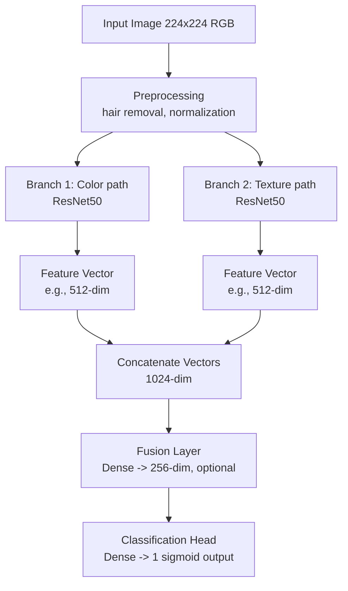
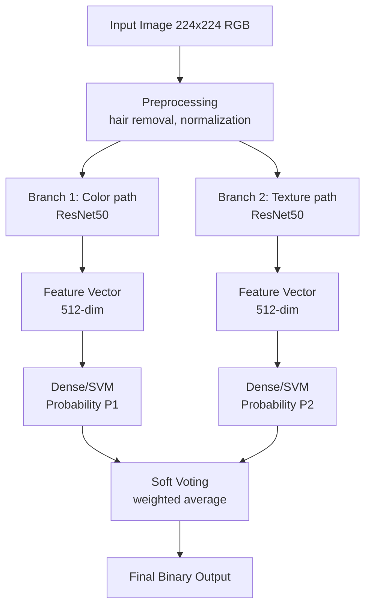

# Eigene Klassifikations Architektur
Ein Arzt beurteilt Hautläsionen anhand verschiedener aber konkreter Merkmale wie Farbe, Struktur, Asymmetrie etc.
Da neuronale Modelle oft als "Blackbox" wahrgenommen werden und die Nachvollziehbarkeit der Entscheidungen erschwert ist, soll hier ein Ansatz verfolgt werden, der die Entscheidungsfindung des Arztes nachahmt. Insofern soll die Architektur mehrere spezialisierte "Experten"-Netzwerke enthalten, die jeweils auf bestimmte Merkmale der Läsion trainiert werden. Die Ergebnisse dieser Experten-Netzwerke werden dann kombiniert, um eine finale Klassifikation zu erstellen.

## Ansatz 1: Fusion
Aufbau eines **Dualbranch-CNN**, welches die Enschätzung zweier gemeinsam trainierter CNNs per `Fusions-Layer` kombiniert.
  - Zwei CNNs erzeugen gleich große Feature-Vektoren.
  - Fusion der Vektoren; Klassifikation via Dense NN, SVM, Decision Tree.
  - Ausgabe: Wahrscheinlichkeiten für Melanom/Leberfleck.

## Ansatz 2: Soft Voting
Aufbau eines **Dualbranch-CNN**, welches die Enschätzung zweier **getrennt** trainierter CNNs nach Soft Voting kombiniert.
  - Zwei CNNs erzeugen getrennte Feature-Vektoren
  - Jeweils Klassifikation via Dense NN, SVM, Decision Tree
  - Soft-Voting der beiden Wahrscheinlichkeiten für das Endergebnis

