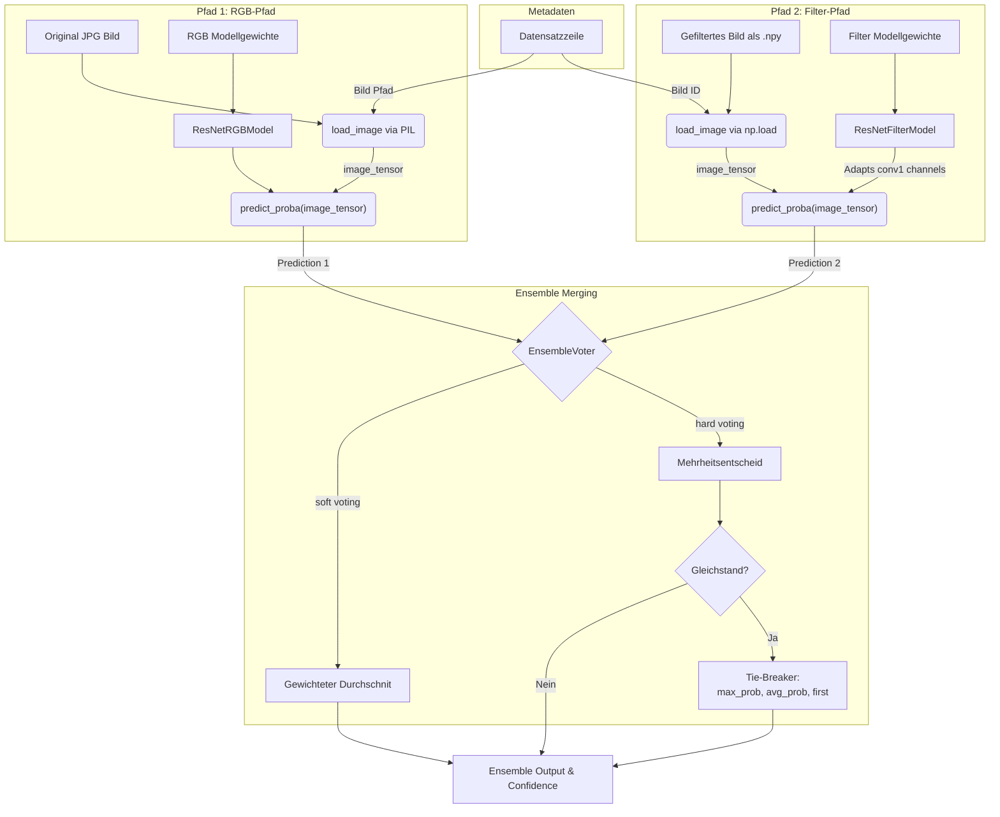

# Ensemble Voting System

Dieses Dokument beschreibt das Ensemble-Voting-System, das entwickelt wurde, um die Vorhersagen mehrerer Modelle (sowohl auf RGB-Bildern als auch auf verschiedenen gefilterten Daten) zu kombinieren und die Klassifikationsgenauigkeit für Hautläsionen (Melanom vs. Nävus) zu verbessern.

## 1. Zusammenfassung des Moduls `voter.py`

Das Modul `voter.py` führt die Vorhersagen verschiedener Modelle in eine endgültige Enscheidung zusammen. Die beiden Hauptkomponenten sind:

### `EnsembleBaseModel` (Abstrakte Basisklasse)
Diese Klasse kapselt das Laden von Modellgewichten, das Laden der zugehörigen Bilddaten und die Inferenz. Jedes am Ensemble teilnehmende Modell muss von dieser Klasse erben und folgende Methoden implementieren:
- `load_model()`: Lädt die Modellarchitektur und die Gewichte (`.pt` Datei).
- `load_image(image_info)`: Lädt das Bild oder die Feature-Matrix (z. B. aus dem Dateisystem), basierend auf den Metadaten.
- `predict_proba(image_tensor)`: Führt einen Forward-Pass durch das Modell aus und gibt die Wahrscheinlichkeiten für die Zielklassen zurück.

Zusätzlich stellt die Klasse eine `run_inference(image_info)` Methode bereit, welche das Laden des Bildes und die anschließende Vorhersage kombiniert.

### `EnsembleVoter`
Diese Klasse orchestriert den Abstimmungsprozess.
- **Initialisierung:** Nimmt eine Liste von Modell-Spezifikationen (`model_specs`), eine Abstimmungsstrategie (`strategy`, z. B. "soft" oder "hard") und optionale Gewichtungen für die Modelle entgegen.
- **Abstimmungsstrategien:**
  - **Soft Voting** (`_soft_vote`): Bildet den (gewichteten) Durchschnitt der Vorhersagewahrscheinlichkeiten aller Modelle.
  - **Hard Voting** (`_hard_vote`): Jedes Modell gibt eine diskrete Klassenvorhersage ab. Die Klasse mit den meisten Stimmen gewinnt.
- **Ausführung:** Die Methode `run()` durchläuft alle Modelle, sammelt die Ergebnisse, wendet die gewählte Strategie an und liefert ein `EnsembleOutput`-Objekt zurück, welches das Endresultat und Konfidenzwerte beinhaltet.

## 2. Verarbeitungspfade und Datenfluss (Beispiel im Notebook)

In der praktischen Anwendung (z. B. im `ensemble_voting_test.ipynb`) fließen Daten aus völlig unterschiedlichen Quellen in das System. Diese Datenströme werden zunächst strikt getrennt verarbeitet, bevor sie in einem finalen Schritt zu einer einzigen Vorhersage verschmolzen werden.

### Verarbeitungspfad 1: Reguläre RGB-Bilder
- **Eingabedaten:** Normale JPG-Bilder aus dem Rohdatensatz (`data/raw/...`).
- **Modell-Klasse (Wrapper):** `ResNetRGBModel`
- **Ablauf:** Die Klasse entnimmt den Bild-Pfad direkt aus der übergebenen Metadaten-Zeile (`image_info`). Das Bild wird zunächst per Python Imaging Library (PIL) im RGB-Format geladen und ohne komplexe Transformationen in einen direkten PyTorch-Tensor (`[1, 3, H, W]`) umgewandelt. Daraufhin nutzt das darauf trainierte Standard-ResNet (mit 3 Eingangskanälen) seine Gewichte, führt die Inferenz durch und gibt einen **eigenen Wahrscheinlichkeitsvektor** für die beiden Klassen ("nv", "mel") aus.

### Verarbeitungspfad 2: Gefilterte Bilder (z.B. Gabor, GLCM, LBP)
- **Eingabedaten:** Vorverarbeitete Merkmalsmatrizen im `.npy`-Format (`data/filtered/...`).
- **Modell-Klasse (Wrapper):** `ResNetFilterModel`
- **Ablauf:** Die Eingabedaten werden vollkommen anders geladen, ähnlich wie es in `dataset_loader.py` während des Trainings geschieht. Aus der `image_id` und dem definierten `filter_name` konstruiert die Klasse den Pfad und nutzt `np.load()`, um direkt den numerischen Array zu extrahieren. Da Filter unterschiedliche Kanaltiefen aufweisen (z. B. Gabor mit 40, LBP mit 1, GLCM mit 32 Kanälen), passt das Modell dynamisch seinen Eingabe-Layer (`conv1`) an. Danach wird in einen Float-Tensor konvertiert und das Modell erzeugt nach dem Passieren der Schichten ebenfalls einen **separaten Wahrscheinlichkeitsvektor**.

### Zusammenführung der Vorhersagen (Merging)
Der eigentliche Zweck des `EnsembleVoter` besteht darin, diese unabgängig verarbeiteten Vektoren aufeinander abzustimmen und harmonisch zusammenzuführen:
1. Das Modul iteriert über alle angemeldeten Modelle (RGB und Filter), triggert deren spezifische `load_image()` und Inferenz-Methoden.
2. Jedes Modell retourniert sein Ergebnis in Form eines `BranchResult` (Teilresultat).
3. **Voting-Strategie anwenden:**
   - **Soft Voting (Standard):** Der EnsembleVoter entnimmt die rohen Wahrscheinlichkeiten aus beiden Pfaden (z. B. RGB: `[0.3, 0.7]`, Gabor: `[0.6, 0.4]`). Die Vektoren werden nun miteinander addiert und durch die jeweilige Gewichtung der Modelle (z. B. 0.5 für RGB und 0.5 für Gabor) gemittelt. Die Klasse mit der höchsten aggregierten Punktzahl wird zum einheitlichen Modell-Output deklariert.
   - **Hard Voting:** Mehrheitsentscheidung basierend auf Einzelvorhersagen (unter Berücksichtigung von Tie-Breakern) bildet das Endresultat.

Somit wandelt das System die Eingaben unterschiedlichster Quellen in genau einen singulären `EnsembleOutput` um, der Label und endgültige Konfidenz ausgibt.

### Datenfluss-Diagramm

Das folgende Diagramm visualisiert die getrennten Wege und das finale Merging für **ein Bild** im Detail:

