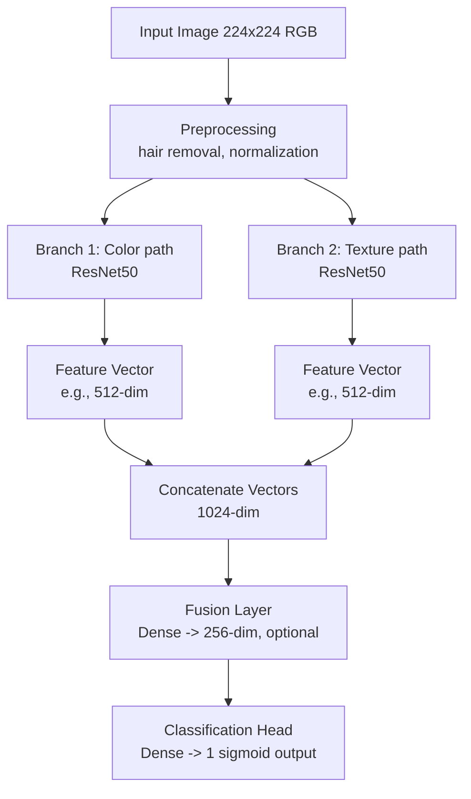
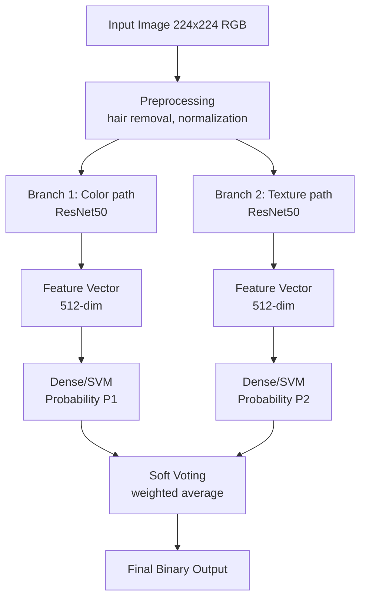

# Eigene Klassifikations Architektur

Als Teil der Modellentwicklung wurde eine eigene Multibranch CNN Architektur entworfen und implementiert.
In Anlehnung an den menschlichen Analyseprozess von Hautläsionen, bei dem verschiedene visuelle Merkmale betrachtet werden, verfolgt diese Architektur den Ansatz, mehrere CNNs auf bestimmte Bildaspekte zu spezialisieren. 
Jeder CNN-Branch soll sich dabei auf unterschiedliche Merkmale der Hautläsion konzentrieren, wie z.B. Farbe, Textur oder Form.
Schließlich werden die Ausgaben der einzelnen Branches kombiniert, um eine finale Klassifikation zu erstellen.

Als Kombinationsstrategien sollen sowohl ein Fusions-Layer als auch ein Ensemble-Voting Ansatz evaluiert werden.


## Datenerweiterung durch Filter

Um die eben beschriebene Spezialisierung der einzelnen Branches zu unterstützen, werden verschiedene Bildfilter auf dem Originaldatensatz angewendet.
Damit soll eine Fokussierung des jeweiligen Branches auf bestimmte Merkmale künstlich herbeigeführt werden.


## Kombinationsstragien - Überblick 

### Ansatz 1: Fusion
Aufbau eines **Dualbranch-CNN**, welches die Enschätzung zweier gemeinsam trainierter CNNs per `Fusions-Layer` kombiniert.
  - Zwei CNNs erzeugen gleich große Feature-Vektoren.
  - Fusion der Vektoren; Klassifikation via Dense NN, SVM, Decision Tree.
  - Ausgabe: Wahrscheinlichkeiten für Melanom/Leberfleck.



### Ansatz 2: Soft Voting
Aufbau eines **Dualbranch-CNN**, welches die Enschätzung zweier **getrennt** trainierter CNNs nach Soft Voting kombiniert.
  - Zwei CNNs erzeugen getrennte Feature-Vektoren
  - Jeweils Klassifikation via Dense NN, SVM, Decision Tree
  - Soft-Voting der beiden Wahrscheinlichkeiten für das Endergebnis



## Ensemble config
Das folgende Objekt, soll das unabhängige Finetunen von separaten CNNs festhalten und weitere Anweisungen zum Setup in einem einzigen Skript zur Verfügung stellen.
Ein separat erstellter Parser soll diese Konfiguration einlesen und die Trainingsroutine entsprechend ausführen.
Damit wird eine flexible und vollständig dokumentierte Trainingspipeline ermöglicht.

```python
ENSEMBLE_CONFIG = {
    "ensemble_id": "approach2_v1",
    "task": "binary_mel_vs_nv",
    "splits": {
        "train_csv": "data/HAM10000_metadata_cleaned.csv",
        "val_ratio": 0.1,
        "test_csv": "data/HAM10000_metadata_cleaned.csv",
        "seed": 42,
    },
    "branches": [ # list of separately trainable branches
        {
            "id": "rgb_resnet50", 
            "model": {
                "backbone": "resnet50", # identifier to load model weights
                "pretrained": True,
                "num_classes": 2,
                "checkpoint": "results/approach2_v1/rgb_resnet50/best.pt", # path to store intermediate model to
            },
            "transforms": {
                "train": ["resize:256", "center_crop:224", "random_hflip", "to_tensor", "normalize:imagenet"],
                "val": ["resize:256", "center_crop:224", "to_tensor", "normalize:imagenet"],
                "test": [] # no transforms as this is not necessary for inference
            },
            "filters": [],  # e.g., ["gabor", "lbp"]
            "training": {
                "epochs": 15,
                "batch_size": 32,
                "optimizer": {"type": "adamw", "lr": 1e-4, "weight_decay": 1e-4},
                "scheduler": {"type": "reduce_on_plateau", "patience": 3},
            },
        },
        {
            "id": "texture_resnet18",
            "model": {
                "backbone": "resnet18",
                "pretrained": True,
                "num_classes": 2,
                "checkpoint": "results/approach2_v1/texture_resnet18/best.pt",
            },
            "transforms": {
                "train": ["resize:256", "center_crop:224", "random_hflip", "to_tensor", "normalize:imagenet"],
                "val": ["resize:256", "center_crop:224", "to_tensor", "normalize:imagenet"],
            },
            "filters": ["gabor", "lbp"],
            "training": {
                "epochs": 15,
                "batch_size": 32,
                "optimizer": {"type": "adamw", "lr": 1e-4, "weight_decay": 1e-4},
                "scheduler": {"type": "reduce_on_plateau", "patience": 3},
            },
        },
    ],
    "voting": { # isolate block definining the combiner
        "strategy": "soft",
        "weights": {"rgb_resnet50": 0.6, "texture_resnet18": 0.4},
        "tie_breaker": "max_prob",  # future: switch to fusion layer here
    },
    "logging": {
        "output_dir": "results/approach2_v1",
        "metrics": ["f1", "auc", "accuracy", "sensitivity", "specificity"],
    },
}
``` 


## Ergebnisse

In den folgenden Zwischenergebnissen werden die Resultate verschiedener Tests zu unterschiedlicher Zeitpunkten und Fortschrittsstufen der Entwicklung dokumentiert. Es ist zu beachten, dass die Ergebnisse nicht direkt vergleichbar sind, da sie auf unterschiedlichen Datensätzen, Trainingsläufen und Hyperparametern basieren. Dennoch bieten sie wertvolle Einblicke in die Entwicklung der Multibranch Architektur und die Auswirkungen verschiedener Designentscheidungen.

Des weiteren ist wichtig zu beachten, dass der Grunddatensatz HAM10000 stark ungleichgewichtig ist, was die Interpretation der Ergebnisse erschwert. Häufig dient die Area Under the Curve (AUC) als primäre Metrik, da sie eine gute Balance zwischen Sensitivität und Spezifität bietet, insbesondere bei ungleichgewichtigen Datensätzen. Dennoch sollten auch andere Metriken wie F1-Score, Genauigkeit und Sensitivität berücksichtigt werden, um ein umfassenderes Bild der Modellperformance zu erhalten. 

Die Metriken soll hier noch einmal kurz erklärt werden:
- Sensitivity (True Positive Rate): Anteil der korrekt als Melanom klassifizierten tatsächlichen Melanome. Bei medizinischen Anwendungen besonders wichtig, da falsch negative Ergebnisse (übersehene Melanome) gefährlicher sind, als falsch positive (fälschlicherweise als Melanom klassifizierte Leberflecken).
- Specificity (True Negative Rate): Anteil der korrekt als Leberfleck klassifizierten Leberflecken. Hohe Spezifität bedeutet wenige falsch positive Ergebnisse, ist aber irreführend, wenn eine Klasse stark überrepräsentiert ist.
- Accuracy: Anteil der korrekt klassifizierten Bilder an der Gesamtzahl. Irreführend bei ungleichgewichtigen Datensätzen, da ein Modell, das immer die Mehrheitsklasse vorhersagt, eine hohe Accuracy erzielen kann, ohne tatsächlich gut zu klassifizieren.
- ROC AUC: Maß für die Trennfähigkeit des Modells über alle Schwellenwerte, basierend auf True Positive Rate vs. False Positive Rate. Werte nahe 1.0 sind ideal, 0.5 bedeutet Zufallsleistung. Kompromiss aus Sensitivität und Spezifität, aber kann durch ungleichgewichtige Klassen zu optimistisch sein.
- F1 Macro: Durchschnittlicher F1-Score über alle Klassen, wobei jede Klasse gleich gewichtet wird. Schlechte Performance auf der Minderheitenklasse (Melanom) führt zu einem niedrigen Macro F1 Score, auch wenn die Mehrheitsklasse (Leberfleck) gut klassifiziert wird.
- F1 Binary: Harmonisches Mittel aus Precision und Recall für die positive Klasse (Melanom). Bei ungleichgewichtigen Datensätzen oft niedriger als AUC, da es die schlechte Performance auf der Minderheitenklasse stärker bestraft.
- TN: Anzahl der True Negatives (korrekt als Leberfleck klassifizierte Bilder)
- FP: Anzahl der False Positives (fälschlicherweise als Melanom klassifizierte Leberflecken)
- FN: Anzahl der False Negatives (fälschlicherweise als Leberfleck klassifizierte Melanome)
- TP: Anzahl der True Positives (korrekt als Melanom klassifizierte Bilder)

### Zwischenergebnisse vom einfachen Training 25.02.2026

Die verwendeten Modelle sind in der [FAUBox](https://faubox.rrze.uni-erlangen.de/getlink/fiBdx9pHi9z1Qo3cPAcJmh/Dermascan) abgelegt.

Um einen erste Eindruck der Sinnhaftigkeit der Multibranch Architektur zu gewinnen, wurden noch unter manueller Arbeit 4 ResNet-Modelle trainiert, von denen jedes auf einem anderen Filter-Datensatz trainiert wurde (Original RGB, LBP, Gabor, GLCM). Alle Modelle wurden mit den gleichen Hyperparametern trainiert (`30 Epochen`, `Batch Size 16`, `AdamW Optimizer mit LR 1e-4 und Weight Decay 1e-4`, `ReduceOnPlateau Scheduler mit Patience 3`).

Es wurden 10 verschiedene Ensemble-Konfigurationen evaluiert, die sich in der Auswahl der Branches und der Kombinationsstrategie (Soft vs. Hard Voting) unterscheiden. Dabei sind auch die 4 Einzelmodelle als "Ensemble" Konfigurationen aufgeführt, um die Performance der kombinierten Modelle mit den Einzelmodellen vergleichen zu können.
Die folgende Tabelle fasst die Ergebnisse der verschiedenen Konfigurationen, sortiert nach Area Under the Curve (AUC), zusammen

| Model Name | Sensitivity | ROC AUC | Specificity | Accuracy | F1 Binary | F1 Macro | TN | FP | FN | TP |
| :--- | :--- | :--- | :--- | :--- | :--- | :--- | :--- | :--- | :--- | :--- |
| **ensemble_gabor_rgb_soft** | 0.5928 | 0.9300 | 0.9662 | 0.9130 | 0.6600 | 0.8051 | 972 | 34 | 68 | 99 |
| **gabor_filtered_standalone** | 0.5749 | 0.9240 | 0.9543 | 0.9003 | 0.6214 | 0.7820 | 960 | 46 | 71 | 96 |
| **rgb_standalone** | 0.4491 | 0.9065 | 0.9632 | 0.8900 | 0.5376 | 0.7376 | 969 | 37 | 92 | 75 |
| **ensemble_all_soft** | 0.3832 | 0.9231 | 0.9761 | 0.8917 | 0.5020 | 0.7206 | 982 | 24 | 103 | 64 |
| **ensemble_lbp_rgb_soft** | 0.3593 | 0.8958 | 0.9722 | 0.8849 | 0.4706 | 0.7030 | 978 | 28 | 107 | 60 |
| **ensemble_all_hard** | 0.3653 | 0.8293 | 0.9751 | 0.8883 | 0.4822 | 0.7098 | 981 | 25 | 106 | 61 |
| **ensemble_glcm_rgb_soft** | 0.3234 | 0.9096 | 0.9722 | 0.8798 | 0.4337 | 0.6832 | 978 | 28 | 113 | 54 |
| **lbp_filtered_standalone** | 0.2934 | 0.8259 | 0.9592 | 0.8645 | 0.3813 | 0.6526 | 965 | 41 | 118 | 49 |
| **glcm_filtered_standalone** | 0.2515 | 0.8585 | 0.9761 | 0.8730 | 0.3605 | 0.6450 | 982 | 24 | 125 | 42 |

Für dieses Zwischenergebnis lässt sich festhalten, dass die Kombination von RGB und Gabor gefilterten Bildern in einem Soft Voting Ensemble die beste Performance erzielt hat. Interessanterweise sind die beiden Einzelmodelle, die auf den Original RGB Bildern bzw. den Gabor gefilterten Bildern trainiert wurden, die nächsten Verfolger, was darauf hindeutet, dass beide Bildformate wichtige Informationen für die Klassifikation liefern. Im Hinblick auf die Sensitivität ist dennoch anzumerken, dass die Werte für alle Modelle eher gering sind und damit die Gefahr von übersehenen Melanomen ein ernstzunehmendes Risiko darstellt. Es ist allerdings zu erwarten, dass diese Ergebnisse durch bessere Hyperparameter, größere Modelle und mehr Maßnahmen gegen das Ungleichgewicht der Klassen deutlich verbessert werden können.

