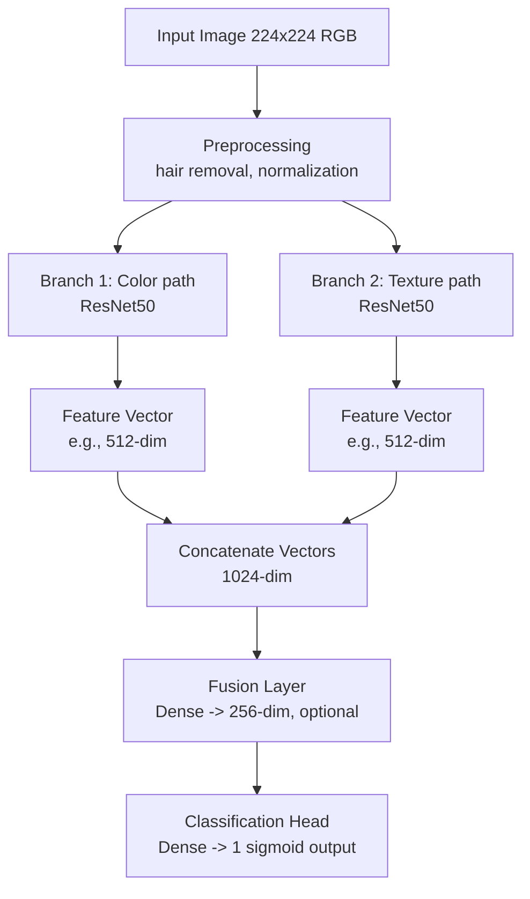
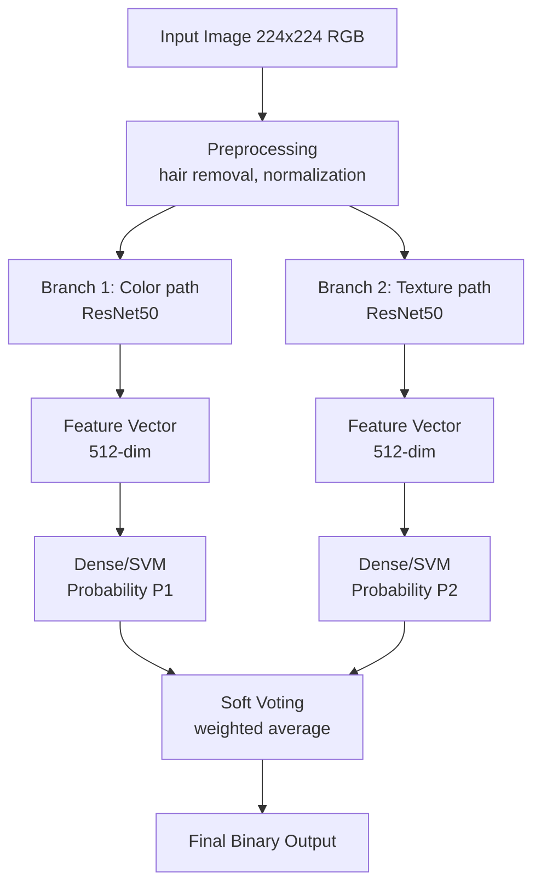

# Eigene Klassifikations Architektur

Als Teil der Modellentwicklung wurde eine eigene Multibranch CNN Architektur entworfen und implementiert.
In Anlehnung an den menschlichen Analyseprozess von Hautläsionen, bei dem verschiedene visuelle Merkmale betrachtet werden, verfolgt diese Architektur den Ansatz, mehrere CNNs auf bestimmte Bildaspekte zu spezialisieren. 
Jeder CNN-Branch soll sich dabei auf unterschiedliche Merkmale der Hautläsion konzentrieren, wie z.B. Farbe, Textur oder Form.
Schließlich werden die Ausgaben der einzelnen Branches kombiniert, um eine finale Klassifikation zu erstellen.

Als Kombinationsstrategien sollen sowohl ein Fusions-Layer als auch ein Soft-Voting Ansatz evaluiert werden.


## Datenerweiterung durch Filter

Um die eben beschriebene Spezialisierung der einzelnen Branches zu unterstützen, werden verschiedene Bildfilter auf dem Originaldatensatz angewendet.
Damit soll eine Fokussierung des jeweiligen Branches auf bestimmte Merkmale künstlich herbeigeführt werden.


## Kombinationsstragien - Überblick 

### Ansatz 1: Fusion
Aufbau eines **Dualbranch-CNN**, welches die Enschätzung zweier gemeinsam trainierter CNNs per `Fusions-Layer` kombiniert.
  - Zwei CNNs erzeugen gleich große Feature-Vektoren.
  - Fusion der Vektoren; Klassifikation via Dense NN, SVM, Decision Tree.
  - Ausgabe: Wahrscheinlichkeiten für Melanom/Leberfleck.



### Ansatz 2: Soft Voting
Aufbau eines **Dualbranch-CNN**, welches die Enschätzung zweier **getrennt** trainierter CNNs nach Soft Voting kombiniert.
  - Zwei CNNs erzeugen getrennte Feature-Vektoren
  - Jeweils Klassifikation via Dense NN, SVM, Decision Tree
  - Soft-Voting der beiden Wahrscheinlichkeiten für das Endergebnis



## Ensemble config
Das folgende Objekt, soll das unabhängige Finetunen von separaten CNNs festhalten und weitere Anweisungen zum Setup in einem einzigen Skript zur Verfügung stellen.
Ein separat erstellter Parser soll diese Konfiguration einlesen und die Trainingsroutine entsprechend ausführen.
Damit wird eine flexible und vollständig dokumentierte Trainingspipeline ermöglicht.

```python
ENSEMBLE_CONFIG = {
    "ensemble_id": "approach2_v1",
    "task": "binary_mel_vs_nv",
    "splits": {
        "train_csv": "data/HAM10000_metadata_cleaned.csv",
        "val_ratio": 0.1,
        "test_csv": "data/HAM10000_metadata_cleaned.csv",
        "seed": 42,
    },
    "branches": [ # list of separately trainable branches
        {
            "id": "rgb_resnet50", 
            "model": {
                "backbone": "resnet50", # identifier to load model weights
                "pretrained": True,
                "num_classes": 2,
                "checkpoint": "results/approach2_v1/rgb_resnet50/best.pt", # path to store intermediate model to
            },
            "transforms": {
                "train": ["resize:256", "center_crop:224", "random_hflip", "to_tensor", "normalize:imagenet"],
                "val": ["resize:256", "center_crop:224", "to_tensor", "normalize:imagenet"],
                "test": [] # no transforms as this is not necessary for inference
            },
            "filters": [],  # e.g., ["gabor", "lbp"]
            "training": {
                "epochs": 15,
                "batch_size": 32,
                "optimizer": {"type": "adamw", "lr": 1e-4, "weight_decay": 1e-4},
                "scheduler": {"type": "reduce_on_plateau", "patience": 3},
            },
        },
        {
            "id": "texture_resnet18",
            "model": {
                "backbone": "resnet18",
                "pretrained": True,
                "num_classes": 2,
                "checkpoint": "results/approach2_v1/texture_resnet18/best.pt",
            },
            "transforms": {
                "train": ["resize:256", "center_crop:224", "random_hflip", "to_tensor", "normalize:imagenet"],
                "val": ["resize:256", "center_crop:224", "to_tensor", "normalize:imagenet"],
            },
            "filters": ["gabor", "lbp"],
            "training": {
                "epochs": 15,
                "batch_size": 32,
                "optimizer": {"type": "adamw", "lr": 1e-4, "weight_decay": 1e-4},
                "scheduler": {"type": "reduce_on_plateau", "patience": 3},
            },
        },
    ],
    "voting": { # isolate block definining the combiner
        "strategy": "soft",
        "weights": {"rgb_resnet50": 0.6, "texture_resnet18": 0.4},
        "tie_breaker": "max_prob",  # future: switch to fusion layer here
    },
    "logging": {
        "output_dir": "results/approach2_v1",
        "metrics": ["f1", "auc", "accuracy", "sensitivity", "specificity"],
    },
}
``` 
