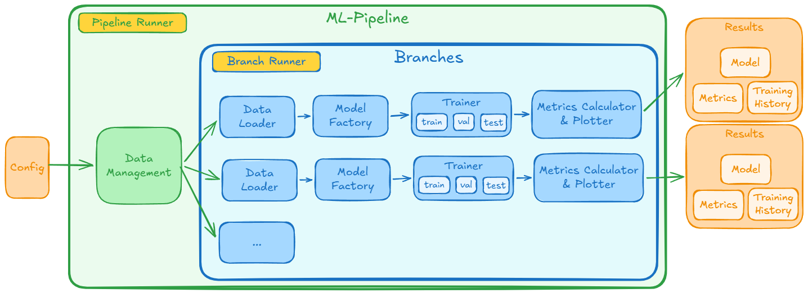

# Trainingspipeline

Die Trainingspipeline entstand nach der Entscheidung für eine Multibranch-Architektur. Diese Architektur untersucht mehrere Sichtweisen auf dieselbe Hautläsion: Ein Branch kann mit RGB-Bildern arbeiten, andere Branches mit gefilterten Repräsentationen wie Gabor, LBP oder GLCM. Dadurch entstand die Notwendigkeit, viele Experimente mit unterschiedlichen Eingaben, Modellen und Hyperparametern vergleichbar durchführen zu können.

Ohne eine gemeinsame Pipeline wären die Ergebnisse der Branches nur eingeschränkt vergleichbar. Unterschiede im Datensplit, in der Normalisierung, Augmentierung, Klassengewichtung oder Threshold-Wahl können die Metriken stark beeinflussen. Die Pipeline stellt deshalb einen einheitlichen Experimentrahmen bereit: Sie lädt eine Konfiguration, erzeugt Train-/Val-/Test-Splits, baut Datenloader und Modell, trainiert den Branch, bewertet ihn und speichert alle relevanten Artefakte. Dadurch können aus vielen Trainingsläufen gezielt die besten Modelle ausgewählt werden, die später über Ensemble Voting kombiniert werden.

## Konfiguration

Die Pipeline wird über JSON-nahe Pydantic-`BaseModel`-Klassen konfiguriert. Das ist sinnvoll, weil ein Trainingslauf viele verschachtelte Entscheidungen enthält: Modelltyp, Filtertyp, Loss-Funktion, Optimizer, Scheduler, Batchgröße, Augmentierungen, Sampler und Seed. Pydantic validiert diese Werte früh, wandelt sie in typisierte Python-Objekte um und verhindert so viele Fehler, die sonst erst während des Trainings auffallen würden.

Die Konfigurationen sind außerdem gut serialisierbar. Dadurch kann die verwendete Branch-Konfiguration zusammen mit Modell, Metriken und Trainingsverlauf gespeichert werden. Für Auditing und Reproduzierbarkeit ist das zentral, weil ein später genutztes Modell nur dann nachvollziehbar ist, wenn seine exakten Trainingsparameter erhalten bleiben.

## Datenmanagement und Augmentierung

Die Pipeline nutzt PyTorch-`DataLoader`, weil Training in Batches, paralleles Laden, Shuffling und optional gewichtetes Sampling damit direkt unterstützt werden. Die `DataLoaderFactory` kapselt dabei, ob ein Branch RGB-Bilder oder vorberechnete `.npy`-Feature-Maps lädt. Der Trainer erhält am Ende immer Tensor-Batches und muss die konkrete Datenquelle nicht kennen.

Augmentierungen werden mit Albumentations aufgebaut. Die Bibliothek bietet performante und gut kombinierbare Bildoperationen wie Resize, Crop, Rotation, Flip, ColorJitter, CoarseDropout, Normalisierung und `ToTensorV2`. Der `AugmentationBuilder` übersetzt die konfigurierten `AugmentationType`-Werte in eine passende Transformationspipeline und berücksichtigt dabei die Eingabegröße der jeweiligen Modellarchitektur.

Nicht jede Augmentierung ist für jede Repräsentation gleich geeignet. Geometrische Operationen können für RGB- und Filterdaten sinnvoll sein, solange die Läsion fachlich erhalten bleibt. Farbveränderungen wie `ColorJitter` passen dagegen vor allem zu RGB-Bildern, weil Gabor-, LBP- oder GLCM-Kanäle keine echten Farbkanäle darstellen. Validierungs- und Testdaten werden bewusst nur deterministisch resized und normalisiert, damit die Bewertung stabil und reproduzierbar bleibt.

## Training und Bewertung

Während des Trainings wird nach jeder Epoche auf dem Validierungsset geprüft, wie gut das Modell generalisiert. Das beste Modell wird anhand des Val-F1-Macro-Scores gespeichert. Diese Metrik ist geeigneter als reine Accuracy, weil der HAM10000-Datensatz in der binären Melanom-Klassifikation unausgeglichen ist. Macro-F1 gewichtet beide Klassen gleich und verhindert, dass ein Modell nur wegen guter Leistung auf der häufigeren Nicht-Melanom-Klasse bevorzugt wird.

Nach dem Training wird auf dem Validierungsset ein geeigneter Threshold gesucht. Der Standardwert `0.5` ist bei unausgeglichenen Daten und medizinisch unterschiedlichen Fehlerkosten nicht zwingend optimal. Die Pipeline sucht deshalb einen Threshold, der eine Mindest-Spezifität erfüllt und dabei die Sensitivität maximiert. Erst danach wird das Testset mit diesem Threshold ausgewertet, damit das Testset nicht zur Modellentscheidung verwendet wird.

Neben Accuracy werden Sensitivität, Spezifität, F1-Werte, AUC und MCC betrachtet. Besonders wichtig ist die Sensitivität, weil falsch negative Melanom-Vorhersagen kritisch sind. Gleichzeitig muss die Spezifität beachtet werden, damit nicht zu viele gutartige Läsionen fälschlich als auffällig bewertet werden.

## Transfer Learning und Modellvarianten

Transfer Learning war anfangs ein naheliegender Ansatz, weil vortrainierte Torchvision-Modelle bereits allgemeine visuelle Merkmale wie Kanten, Formen und Texturen gelernt haben. Die Pipeline unterstützt daher `pretrained=true` sowie das optionale Einfrieren bestehender Gewichte über `freeze_weights=true`.

Im Projekt zeigte sich jedoch, dass das reine Trainieren der letzten Schicht bei eingefrorenen Gewichten schlechte Ergebnisse liefert. Statt den Backbone vollständig einzufrieren, ist es jedoch sinnvoller, mehr Schichten weiterzutrainieren und das Modell stärker an die Hautläsionsdaten anzupassen. Besonders bei Filterdaten unterscheiden sich Kanalzahl und Bedeutung der Eingaben stark von normalen RGB-Fotos. Ein Gabor- oder GLCM-Branch verarbeitet technische Merkmalsrepräsentationen, nicht natürliche Farbbilder. Diese Flexibilität war wichtig, um unterschiedliche Transfer-Learning-Strategien kontrolliert prüfen zu können.

Die `ModelFactory` macht verschiedene Torchvision-Architekturen vergleichbar, etwa ResNet, EfficientNet, MobileNet, Inception und SqueezeNet. Bei Filterdaten wird der erste Conv-Layer an die jeweilige Kanalzahl angepasst, und der Output-Layer wird passend zur binären Klassifikation ersetzt.

## Umgang mit Klassenungleichgewicht

Der Datensatz enthält deutlich weniger Melanome als gutartige Nävi. Die Pipeline kombiniert deshalb mehrere Maßnahmen gegen Klassenungleichgewicht. Der `WeightedRandomSampler` wirkt auf der Datenebene: Melanom-Beispiele können häufiger in Trainingsbatches gezogen werden, obwohl sie im Datensatz seltener sind. Gewichtete Loss-Funktionen wirken auf der Optimierungsebene: `pos_weight` bei `BCEWithLogitsLoss` oder `class_weights` bei `CrossEntropyLoss` erhöhen die Bestrafung für Fehler auf der Minderheitsklasse.

Zusätzlich wirkt die Threshold-Optimierung auf der Entscheidungsebene. Das Modell gibt zunächst Wahrscheinlichkeiten aus; erst der Threshold entscheidet zwischen Melanom und Nicht-Melanom. Durch die Wahl eines geeigneten Thresholds kann die Pipeline Sensitivität und Spezifität besser an die medizinische Aufgabenstellung anpassen.

## Auditing und Architektur

Die Pipeline speichert pro Branch Modellgewichte, Branch-Konfiguration, Trainingsverlauf, finale Metriken und Plots wie Confusion Matrix, ROC-Kurve, Precision-Recall-Kurve und Konfidenzverteilung. Zusätzlich werden Parameter, Metriken, Artefakte und Modelle über MLflow protokolliert. Dadurch bleibt nachvollziehbar, mit welchen Daten und Einstellungen ein Modell entstanden ist.

Architektonisch ist die Pipeline modular aufgebaut. Der `PipelineOrchestrator` koordiniert den Gesamtablauf, die `DataLoaderFactory` baut die Loader, der `AugmentationBuilder` erzeugt Transformationen, die `ModelFactory` baut Modelle, der `Trainer` übernimmt Training und Evaluation, der `MetricsCalculator` berechnet Metriken und Thresholds, und `Plotter` sowie `MLFlowLogger` speichern Ergebnisse. Diese Trennung macht neue Branches, Filter, Modelle oder Trainingsstrategien leichter integrierbar und hält die Multibranch-Experimente reproduzierbar vergleichbar.

## Fazit

Die Pipeline ist der methodische Rahmen, um die Multibranch-Idee praktisch zu prüfen. Verschiedene Datenrepräsentationen, Modellfamilien und Trainingsentscheidungen können unter kontrollierten Bedingungen verglichen werden, ohne dass Unterschiede im Ablauf die Aussagekraft der Ergebnisse verzerren.

Dadurch lassen sich die besten Branch-Modelle gezielt als Kandidaten für das Ensemble Voting auswählen und für eine spätere Nutzung in der App nachvollziehbar dokumentieren. Die Pipeline verbindet damit Training, Bewertung und Rückverfolgbarkeit zu einem einheitlichen Experimentprozess.

## Siehe auch

- [Multibranch Architektur](./multibranch_architecture.md)
- [Auditierung](./auditing.md)
- [Experimentergebnisse](./experiment_results.md)
- [Machine Learning Übersicht](./README.md)
- [Modell Export](./onnx_export.md)