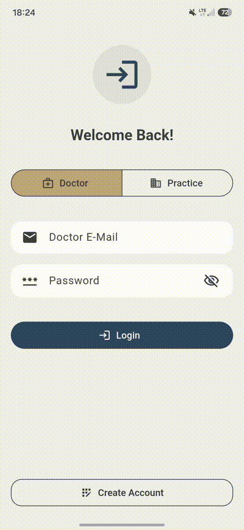
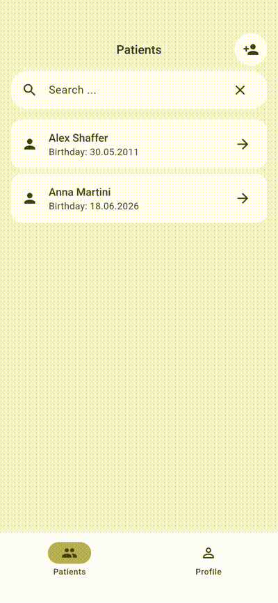
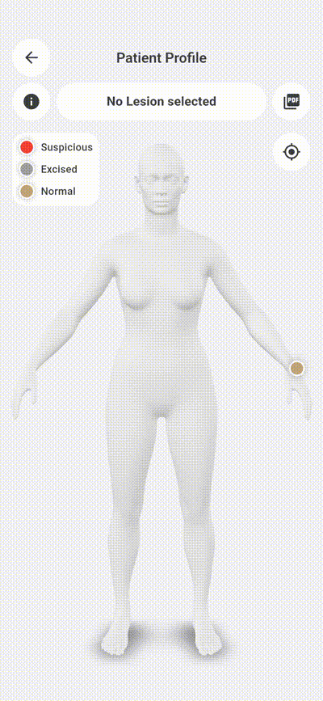
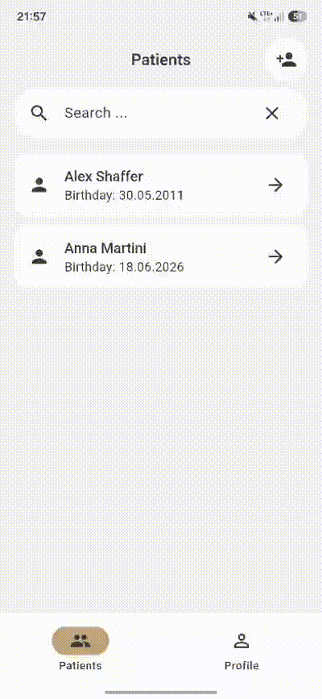

# DermaScan - App-Dokumentation

## Zielsetzung und Kontext

Die vorliegende Dokumentation beschreibt die Konzeption und Implementierung einer mobilen Flutter-Anwendung zur dermatologischen Hautläsionsverwaltung. Das Projekt entstand in enger Zusammenarbeit mit einer Dermatologin. Ziel war es, die realen Anforderungen, klinischen Arbeitsabläufe und Dokumentationspflichten einer dermatologischen Praxis präzise zu erfassen und in eine benutzerzentrierte Softwarelösung zu überführen.

Die Anwendung unterstützt Dermatologen gezielt bei der langfristigen Dokumentation, der strukturierten Verlaufskontrolle sowie der Diagnose von Hautläsionen. Die App führt Patientenverwaltung, Bilddokumentation und automatisierte Berichterstellung (PDF) in einem System zusammen.

## Konten- und Rollenmodell

Um den organisatorischen Strukturen im medizinischen Alltag gerecht zu werden, trennt die Anwendung strikt zwischen zwei Benutzerrollen:

* **Praxis-Account:** Repräsentiert die übergeordnete medizinische Einrichtung (z. B. eine Gemeinschaftspraxis oder Klinik). Diese Rolle übernimmt die administrative Verwaltung und autorisiert die zugehörigen Ärztinnen und Ärzte.
* **Arzt-Account:** Wird von den behandelnden Dermatologen genutzt. Dieser Account berechtigt zur Patientenverwaltung, zur Durchführung von Untersuchungen, zur Erstellung von Diagnosen und zur Einsicht in die Historie.

### Registrierungs- und Verifikationsprozess

Sowohl Praxis- als auch Arzt-Accounts können direkt in der Anwendung registriert werden. Zum Schutz sensibler Patientendaten ist der Registrierungsprozess zweistufig aufgebaut: Nach der Erstellung befindet sich ein neuer Arzt-Account zunächst in einem Wartestatus und besitzt keinerlei Datenzugriff. Erst wenn ein Praxis-Account die Beitrittsanfrage des Arztes explizit bestätigt, wird dieser der Praxis zugeordnet und freigeschaltet.

### Datenzugriff und Datenschutz

Das Berechtigungskonzept folgt strengen Mustern zur Wahrung der ärztlichen Schweigepflicht und des Datenschutzes:

* Alle verifizierten Ärzte einer Praxis teilen sich den Zugriff auf die Patientendaten *dieser spezifischen* Praxis, um Urlaubs- oder Schichtvertretungen zu ermöglichen.
* Ärzte verschiedener Praxen sind vollständig voneinander isoliert; ein organisationsübergreifender Datenzugriff ist technisch ausgeschlossen.
* Ärzte können eine Praxis jederzeit eigenständig verlassen, während der Praxis-Account die Berechtigung besitzt, Ärzte hinzuzufügen oder zu entfernen.

---

## App-Features

Der Funktionsumfang der Anwendung ist exakt auf den klinischen Untersuchungspfad abgestimmt. Er begleitet den Arzt vom Erstkontakt über die visuelle Analyse bis hin zur Archivierung.

### Arzt- und Praxisverwaltung

Um einen Patienten zu dokumentieren, muss der Arzt zunächst ein eigenes Benutzerkonto anlegen. Dieses Konto ist zu Beginn mit keiner Praxis verknüpft, sodass der Arzt einer bestehenden Praxis beitreten muss. Die Praxiszuordnung ist für die Verwaltung von Patientendaten entscheidend, da sie den Zugriff auf die Daten anderer Ärzte derselben Praxis regelt.


Gleichermaßen muss ein Praxisadministrator ein eigenes Konto anlegen, um die Praxis zu registrieren. Der Administrator kann dann weitere Ärzte einladen, die der Praxis zugeordnet werden sollen. Damit ist sichergestellt, dass nur autorisierte Ärzte Zugriff auf die Patientendaten der Praxis erhalten.



#### Arztverwaltung und Mehrbenutzerfähigkeit

Jeder Arzt ist genau einer Praxis zugeordnet und besitzt ein eigenes Benutzerkonto mit eindeutiger E-Mail-Adresse. Ärzte derselben Praxis können die Patientendaten anderer zugeordneter Kollegen einsehen, sodass die Behandlung im Team konsistent dokumentiert und fortgeführt werden kann.

**Das Praxiskonto verwaltet den Zugriff über ein Einladungsmodul**: Einladungen an neue Ärzte können in einem eigenen Fenster eingesehen und bei Bedarf jederzeit zurückgenommen werden, etwa bei versehentlichem Versand. Sobald ein Arzt eine Einladung akzeptiert, erhält er Zugriff auf die Patientendaten der Praxis; dieser Zugriff kann durch die Praxisadministration jederzeit wieder entzogen werden, indem der Arzt aus der Praxis entfernt wird.


### Patientenverwaltung und Anamnese

Das Anlegen eines neuen Patienten bildet den Startpunkt der Dokumentation. Die zu erfassenden Parameter wurden gemeinsam mit der Fachärztin definiert. Sie umfassen neben den demografischen Stammdaten gezielt jene Risikofaktoren, die für eine fundierte Hautkrebsdiagnostik und -prävention maßgeblich sind:

* **Stammdaten:** Vorname, Nachname, Geburtsdatum, biologisches Geschlecht.
* **Sonnen- und Lebensstilfaktoren:** Nutzung von Sonnenschutzmitteln, Historie von Sonnenbränden, Nutzung von Solarien.
* **Medizinische Vorgeschichte:** Eigene Melanom-Vorgeschichte, familiäres Vorkommen von Hautkrebserkrankungen, vorausgegangene dermatologische Operationen.
* **Herkunft:** Geburtsland sowie aktuelles Wohnsitzland (zur Einschätzung der kumulativen UV-Exposition).

Alle Daten können bei Folgeuntersuchungen aktualisiert werden. In der zentralen Patientenübersicht werden diese Risikofaktoren kompakt zusammengefasst, um dem Arzt sofort den Kontext des Patienten zu vermitteln.



> **Hinweis:** Um einen Patienten aus der Praxis zu löschen, muss der Arzt das Patientenprofil öffnen und die Option "Delete" auswählen. **Es dürfen keine Läsionen mehr mit dem Patienten verknüpft sein**, da sonst die Datenintegrität nicht gewährleistet ist.

### Das digitale Patientenprofil & Interaktive 3D-Körperkarte

Das Patientenprofil ist die zentrale Arbeitsumgebung für den Mediziner. Um eine intuitive Dokumentation zu ermöglichen, wurde eine interaktive 3D-Körperdarstellung integriert. Im Gegensatz zu klassischen Systemen, die mit starren, vordefinierten Text-Kategorien (z. B. „Rücken“) arbeiten, erlaubt dieses Modell die präzise Platzierung von Hautläsionen im dreidimensionalen Raum.

#### Funktionen der 3D-Körperkarte:

* **Freie Interaktion:** Das dreidimensionale Modell lässt sich stufenlos drehen und zoomen, um jede anatomische Region exakt zu erreichen.
* **Kameraperspektiven:** Ein Quick-Reset erlaubt das sofortige Zurücksetzen auf die Standardansicht.
* **Präzise Läsionsplatzierung:** Durch Tippen auf das Modell können beliebig viele Läsionen exakt an der realen anatomischen Position markiert werden.


#### Schnellübersicht und Navigation

Zusätzlich zur visuellen Karte bietet das Profil eine effiziente Informationsarchitektur für den Praxisalltag:

* **Diagnose-Timeline:** Ein Direktzugriff auf die letzten fünf dokumentierten Diagnosen. Ein Tippen auf einen Eintrag fokussiert sofort die dazugehörige Läsion auf dem 3D-Modell.
* **Kontext-Info:** Schnelleinsicht der Patienten-Risikofaktoren über ein Info-Symbol, ohne den aktuellen Untersuchungsbildschirm verlassen zu müssen.


### Läsionsverwaltung und Befundung

Wird ein neuer Punkt auf der 3D-Karte gesetzt, öffnet sich der Workflow zur Läsionsverwaltung. Nach Vergabe eines eindeutigen Namens wird ein neuer Untersuchungszeitpunkt (eine Diagnose) initiiert.

#### Medizinische Statusverfolgung

Jede Läsion besitzt einen dynamischen Status, der den klinischen Verlauf widerspiegelt:

* **Verdächtig** (unter Beobachtung)
* **Entfernt** (operativ exzidiert)
* **Histologisch bestätigt** (nach Laborbefund als Melanom klassifiziert)

Da eine Läsion über Jahre hinweg unbegrenzt viele Diagnosen und Bildaufnahmen enthalten kann, wird die morphologische Veränderung lückenlos nachvollziehbar.



>**Hinweis:** Um eine Läsion zu löschen, muss der Arzt das Läsionsprofil öffnen und die Option "Delete" auswählen. Es müssen erst **alle Diagnosen der Läsion gelöscht** werden, bevor die Läsion selbst gelöscht werden kann.

### Automatisierte PDF-Berichterstellung

Für die Archivierung in der primären Praxis-EDV oder für die Weitergabe an den Patienten wurde ein Export-Modul implementiert. Der Arzt kann über eine Checkbox-Auswahl dediziert steuern, welche Läsionen und welche spezifischen Untersuchungszeitpunkte in den Bericht einfließen sollen. Das generierte PDF-Dokument enthält strukturiert alle Stammdaten, Anamnesefaktoren, die bildlichen Dokumentationen sowie die ärztlichen Kommentare.


### Kurzdokumentation

In der App ist eine Kurzdokumentation integriert, die die zentralen App-Funktionen erläutert. Sie ist jederzeit über das eigene Arztprofil zugänglich und bietet eine schnelle Orientierungshilfe für neue Nutzer.



---

## App-Architektur

Die technische Architektur der Anwendung wurde mit Fokus auf Wartbarkeit, Testbarkeit und Ressourceneffizienz entworfen. Als primäres Architekturmuster kommt **MVVM (Model-View-ViewModel)** zum Einsatz. Das gesamte Projekt ist strikt nach dem Clean-Architecture-Gedanken aufgebaut und nutzt das **GetX**-Framework für das Zustandsmanagement, die Dependency Injection und das Routing.

### Modulare Struktur und Feature-Aufteilung

Der Quellcode ist auf oberster Ebene konsequent in die Domänen der beiden Benutzerrollen unterteilt, um eine unabsichtliche Daten- oder Logikverarbeitung zu verhindern. Innerhalb dieser Domänen ist die App in eigenständige, in sich geschlossene Feature-Module zerlegt:

```text
lib/
├── feature/
│   ├── auth/              # Anmeldung & Registrierung (Praxis & Arzt)
│   ├── doctor/            # Arzt-Domäne
│   │   ├── home/          # Zentrale Übersicht des Arztes
│   │   ├── patients/      # CRUD-Operationen für Patienten
│   │   └── profile/       # Persönliche Einstellungen des Arztes
│   ├── praxis/            # Praxis-Domäne
│   │   ├── home/          # Arztverwaltung (Hinzufügen, Entfernen, Freigeben)
│   │   └── profile/       # Stammdaten der medizinischen Einrichtung
│   └── splash/            # App-Startup und Routing-Distribution
```

### MVVM-Implementierung mit GetX

Jedes dieser Features ist intern strikt nach dem MVVM-Muster in drei Komponenten gegliedert:

* **View (UI):** Reine deklarative Widgets, die ausschließlich für das Layout zuständig sind. Sie enthalten keinerlei Business- oder Navigationslogik.
* **Controller (ViewModel):** Verwaltet den Zustand des jeweiligen Screens und kapselt die Interaktionslogik.
* **Binding:** Regelt die Dependency Injection. Es definiert präzise, welche Controller beim Aufruf eines Features instanziiert und im Speicher bereitgestellt werden müssen.

#### Speicher- und Lifecycle-Management

Durch das Routing-System von GetX wird ein hocheffizientes Speichermanagement realisiert. Wenn der Benutzer eine Route (einen Screen) aufruft, sorgt das dazugehörige `Binding` dafür, dass die benötigten Controller bereitgestellt werden. Sobald der Benutzer den Screen wieder verlässt (z. B. durch Zurück-Navigation), schließt GetX diese Controller automatisch (`dispose`) und gibt den beanspruchten RAM-Speicher umgehend frei.

Auf den Einsatz von rechenintensiven `StatefulWidgets` konnte dank des reaktiven Ansatzes vollständig verzichtet werden. Alle dynamischen UI-Elemente sind in `Obx(())`-Widgets gekapselt. Ändert sich eine reaktive Variable (`Rx`) im Controller, registriert GetX dies automatisch und zeichnet ausschließlich das betroffene Widget neu – ohne manuellen Aufruf von `setState`.

### Globale Services (Kern-Infrastruktur)

Zusätzlich zu den flüchtigen Feature-Controllern existieren zwei langlebige Instanzen, die als `GetxService` direkt beim App-Start initialisiert werden und über den gesamten Lebenszyklus hinweg aktiv bleiben. Sie dienen als Abstraktionsschicht für die Datenquellen:

#### `AuthService` (`auth_service.dart`)

Verantwortlich für die gesamte Authentifizierung und Sitzungsverwaltung (Login, Logout, Registrierung). Er hält das aktuelle Benutzerobjekt (Arzt oder Praxis) global im Speicher bereit, sodass jeder Feature-Controller direkt den Kontext des agierenden Nutzers abfragen kann.

#### Datenbank-Services

Die zentrale Schicht für alle Datenoperationen. Die App nutzt **Supabase** als Backend. Um eine lose Kopplung (Loose Coupling) zu garantieren, rufen die Controller niemals direkte Datenbankabfragen auf. Sie kommunizieren ausschließlich mit der Datenbank-Serviceschicht. Zur besseren Übersichtlichkeit wurden die Service-Klassen in fachspezifische Bereiche aufgeteilt. Diese Services führen direkte SQL-Abfragen aus, nehmen die Rohdaten entgegen, transformieren und parsen sie in die stark typisierten Datenmodelle der App (Dart-Objekte) und geben diese an die Controller zurück. Bei einer eventuellen Migration des Datenbackend muss somit nur diese Serviceschicht angepasst werden.

### Der Splash-Screen und dynamisches Routing

Der `SplashScreen` fungiert als intelligenter Gatekeeper beim App-Start. Visuell zeigt er lediglich einen Ladeindikator. Im Hintergrund prüft er über den `AuthService` den aktuellen Sitzungsstatus sowie den Kontotyp des authentifizierten Benutzers. Basierend auf dieser Auswertung wird der Benutzer vollautomatisch auf die korrekte Zielroute geleitet (z. B. direkt zum `DoctorHomeScreen` oder, falls nicht eingeloggt, zur Login-Maske des `Auth`-Features).
