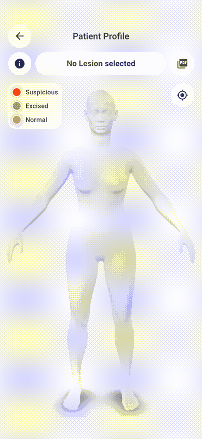

# App Features

The application's scope of features is precisely tailored to the clinical examination path. It accompanies the doctor from the initial contact through visual and AI-supported analysis to archiving.

## Doctor and Practice Management

To document a patient, the doctor must first create their own user account. This account is initially not linked to any practice, so the doctor must join an existing practice. Practice assignment is crucial for managing patient data, as it regulates access to the data by other doctors in the same practice.

Similarly, a practice administrator must create their own account to register the practice. The administrator can then invite other doctors to be assigned to the practice. This ensures that only authorized doctors have access to the practice's patient data.

### Doctor Management and Multi-User Capability

Each doctor is assigned to exactly one practice and has their own user account with a unique email address. Doctors in the same practice can view the patient data of other assigned colleagues, allowing team treatment to be consistently documented and continued.

**The practice account manages access via an invitation module**: Invitations to new doctors can be viewed in a separate window and revoked at any time if necessary, for instance in case of accidental sending. Once a doctor accepts an invitation, they gain access to the practice's patient data; this access can be revoked by the practice administration at any time by removing the doctor from the practice.

## Patient Management and Medical History

Creating a new patient is the starting point for documentation. The parameters to be recorded were defined in collaboration with the specialist. In addition to demographic master data, they specifically include those risk factors that are essential for sound skin cancer diagnostics and prevention:

* **Master Data:** First name, last name, date of birth, biological sex.
* **Sun and Lifestyle Factors:** Use of sunscreen, history of sunburns, use of solariums.
* **Medical History:** Personal history of melanoma, family history of skin cancer, previous dermatological surgeries.
* **Origin:** Country of birth and current country of residence (to estimate cumulative UV exposure).

All data can be updated during follow-up examinations. In the central patient overview, these risk factors are compactly summarized to immediately provide the doctor with the patient's context.

> **Note:** To delete a patient from the practice, the doctor must open the patient profile and select the "Delete" option. **There must be no lesions linked to the patient anymore**, otherwise data integrity cannot be guaranteed.

## The Digital Patient Profile & Interactive 3D Body Map

The patient profile is the central working environment for the medical professional. To enable intuitive documentation, an interactive 3D body representation was integrated. Unlike classic systems that work with rigid, predefined text categories (e.g., "back"), this model allows for the precise placement of skin lesions in three-dimensional space.

### Features of the 3D Body Map:

* **Free Interaction:** The three-dimensional model can be rotated and zoomed seamlessly to precisely reach any anatomical region.
* **Camera Perspectives:** A quick reset allows an immediate return to the default view.
* **Precise Lesion Placement:** By tapping on the model, any number of lesions can be marked exactly at their real anatomical position.

### Quick Overview and Navigation

In addition to the visual map, the profile offers an efficient information architecture for everyday practice:

* **Diagnosis Timeline:** Direct access to the last five documented diagnoses. Tapping an entry immediately focuses on the corresponding lesion on the 3D model.
* **Context Info:** Quick view of the patient's risk factors via an info icon without having to leave the current examination screen.

## Lesion Management and Diagnosis

When a new point is placed on the 3D map, the lesion management workflow opens. After assigning a unique name, a new examination time point (a diagnosis) is initiated.

### Image Capture and Cutout Generation

The doctor can either take the clinical image directly via the mobile device's camera or import it from the gallery. To minimize disruptive factors (such as healthy skin areas or hair) and focus the neural network on the relevant area, an optimized image section – the so-called lesion cutout – is selected by the dermatologist in the next step.

### Medical Status Tracking

Each lesion has a dynamic status that reflects its clinical progression:

* **Suspicious** (under observation)
* **Removed** (surgically excised)
* **Histologically confirmed** (classified as melanoma after laboratory findings)

Since a lesion can contain an unlimited number of diagnoses and image recordings over years, morphological changes can be seamlessly tracked.

>**Note:** To delete a lesion, the doctor must open the lesion profile and select the "Delete" option. **All diagnoses of the lesion must first be deleted** before the lesion itself can be deleted.

## AI-Supported Analysis and Diagnosis Documentation

For each newly recorded diagnosis, the image material is analyzed locally. The system combines classic dermatological evaluation metrics with modern deep learning methods:

1. **Classic ABC Scoring:** Automatic calculation and visual presentation of the criteria *Asymmetry* (A), *Border* (B), and *Color* (C).
2. **Neural Classification:** Calculation of the statistical probabilities for the presence of a *melanoma* compared to a benign *melanocytic nevus* (mole).

Additionally, the doctor documents the examination date, the treating colleague, and free clinical notes. The results are clearly processed for the doctor and serve as an objective, reproducible second opinion (*Decision Support System*).

## Automated PDF Report Generation

An export module was implemented for archiving in the primary practice IT system or for sharing with the patient. Via a checkbox selection, the doctor can specifically control which lesions and which specific examination dates should be included in the report. The generated PDF document contains in a structured manner all master data, medical history factors, visual documentation, calculated AI metrics, as well as the doctor's comments.

