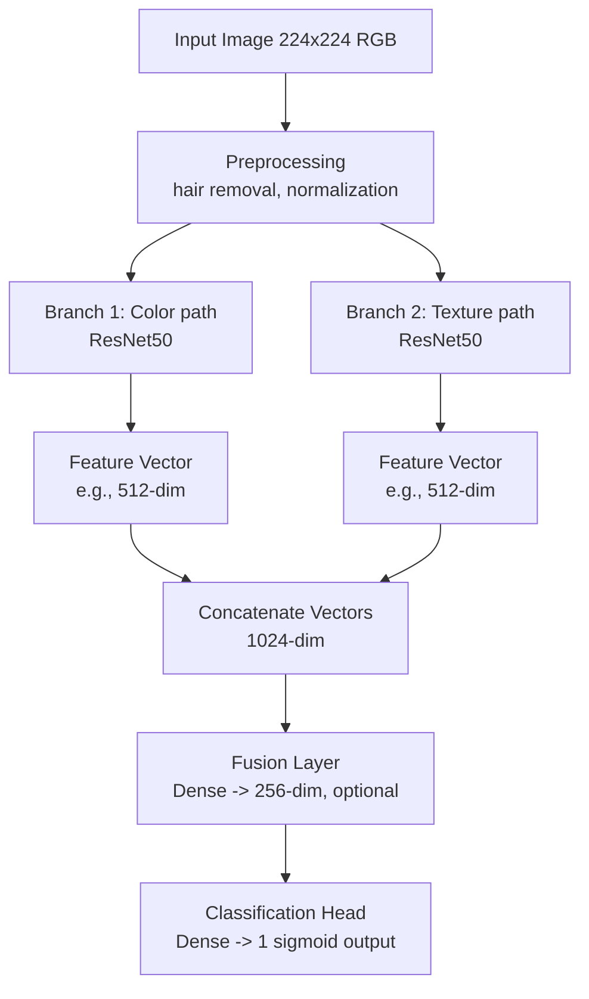
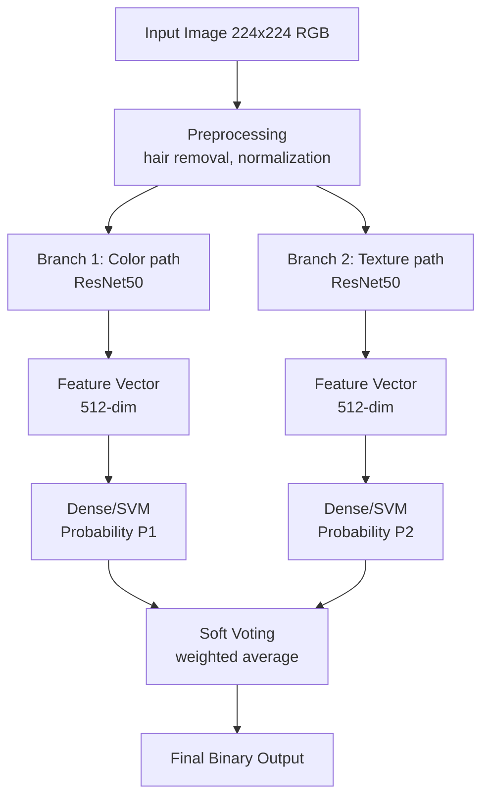

## Experimente mit Strukturfiltern (Gabor Wavelet, Local Binary Pattern, GLCM Contrast)

Gabor
- sieht nur nach einfachem Graufilter aus
- eventuell minimale Hervorhebung von Kontrast um Kanten, d.h. die generelle Form von Objekten wird umrandet
- brauch weiteres experimentieren mit anderen Parametern

Local binary
- scheint Kanten insbesondere bei symmetrischen Formen ausfinding zu machen
- bei asymetrischen Lesionen oder solche, die mehr generelle Fläche umspannen sieht Ergebnisbild einfach nur nach White Noise aus
- scheint Textur auch an stellen hervorzuheben, die ein Mensch beim Betrachten des Originalbilds eher weniger beachtet (nur hilfreich, wenn diese tatsächlich relevante Merkmale sind)

GLCM
- sehr anfällig für Haare und Stiftstriche auf der Haut
- hebt Details in Texturen hervor, die sich erheblich von anderen Texturen in derselben Region unterscheiden
- generell nicht geeignet um Kanten zu erkennen

Gesamtergebnisse:
- vielleicht müssen mehrere Filter übereinander gelegt werden um Struktur und Form hervorzuheben
- Nachjustieren von den Parametern interessant
- weitere Filter recherchieren


## Generelle Architektur (high-level):
**Approach 1: Fusion (Feature-Level)**



**Approach 2: Ensemble + Soft Voting**




### Basis Wrapper Klasse zum finetunen & transfer learning
```
Initialization Phase:

__init__(self, device='cuda')
    ├─ self.device = device
    ├─ self.model = None
    ├─ self.supported_models = {'resnet18', 'resnet50', 'resnet101', ...}
    ├─ self.optimizer = None
    ├─ self.scheduler = None  # ReduceLROnPlateau, etc.
    ├─ self.train_df, val_df, test_df = None
    ├─ self.train_loader, val_loader, test_loader = None
    ├─ self.results = {}  # Store metrics
    └─ self.history = {}  # Store training curves

Configuration Methods (called in sequence):

.set_model(model_name, num_freeze_layers=None)
    └─ Validate model_name in supported_models
    └─ Load pretrained ResNet
    └─ Freeze layers (default: freeze all except final layer)
    └─ Replace final layer with Binary Classification head (2 classes)

.set_data_loaders(train_df, val_df, test_df, batch_size, num_workers)
    └─ Store DataFrames and create PyTorch DataLoaders

.configure_optimizer(optimizer_type='adam', learning_rate=1e-4, weight_decay=0)
    └─ Create optimizer and store as self.optimizer

.configure_scheduler(scheduler_type='reduce_lr_on_plateau', patience=5, factor=0.1)
    └─ Create scheduler callback and store as self.scheduler

.set_output_paths(model_save_dir, results_csv_path, history_plot_dir)
    └─ Create directories if needed
    └─ Store paths

Training & Evaluation:

.train(epochs=50, metrics_to_track=['accuracy', 'loss'])
    └─ Loop through epochs
    └─ For each epoch:
         ├─ Training phase: forward pass, loss, backward, optimizer step
         ├─ Validation phase: forward pass, compute metrics
         ├─ Scheduler step
         ├─ Log history
    └─ Save best model (based on val metric)
    └─ Save last epoch model

.evaluate(data_loader, phase='test')
    └─ Compute metrics (F1, AUC, accuracy, sensitivity, specificity)
    └─ Store in self.results

.generate_id()
    └─ Return: f"{model_name}_{dd:mm:yyyy}_{hh:mm}"

.save_results_to_csv()
    └─ Append row to CSV with: model_id, all metrics, hyperparameters
```