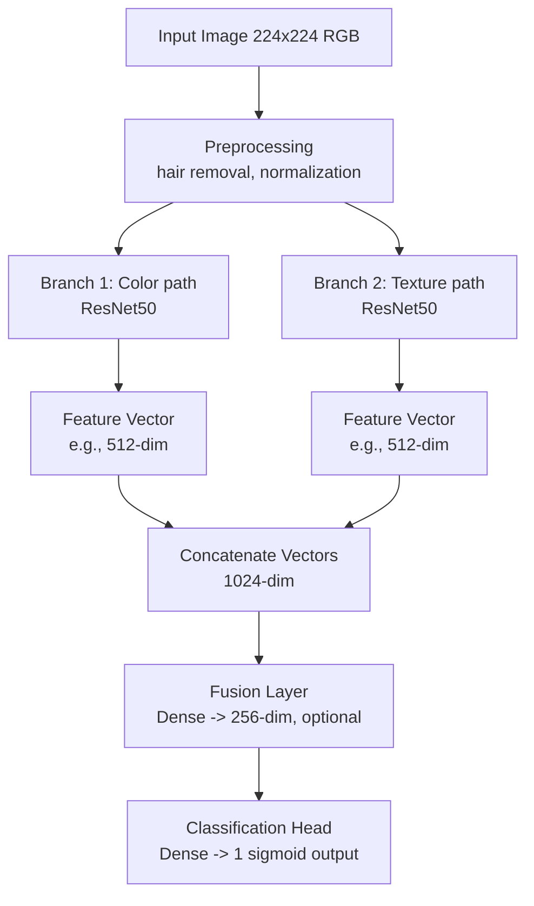
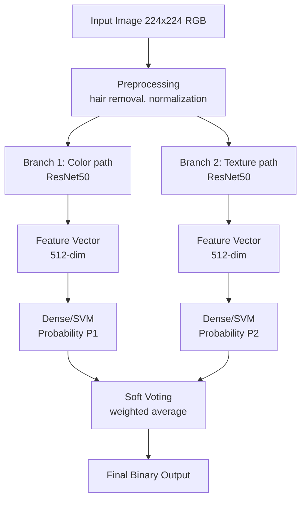

## Experimente mit Strukturfiltern (Gabor Wavelet, Local Binary Pattern, GLCM Contrast)

Gabor
- sieht nur nach einfachem Graufilter aus
- eventuell minimale Hervorhebung von Kontrast um Kanten, d.h. die generelle Form von Objekten wird umrandet
- brauch weiteres experimentieren mit anderen Parametern

Local binary
- scheint Kanten insbesondere bei symmetrischen Formen ausfinding zu machen
- bei asymetrischen Lesionen oder solche, die mehr generelle Fläche umspannen sieht Ergebnisbild einfach nur nach White Noise aus
- scheint Textur auch an stellen hervorzuheben, die ein Mensch beim Betrachten des Originalbilds eher weniger beachtet (nur hilfreich, wenn diese tatsächlich relevante Merkmale sind)

GLCM
- sehr anfällig für Haare und Stiftstriche auf der Haut
- hebt Details in Texturen hervor, die sich erheblich von anderen Texturen in derselben Region unterscheiden
- generell nicht geeignet um Kanten zu erkennen

Gesamtergebnisse:
- vielleicht müssen mehrere Filter übereinander gelegt werden um Struktur und Form hervorzuheben
- Nachjustieren von den Parametern interessant
- weitere Filter recherchieren

## Generelle Architektur (high-level):
**Approach 1: Fusion (Feature-Level)**

**Approach 2: Ensemble + Soft Voting**

